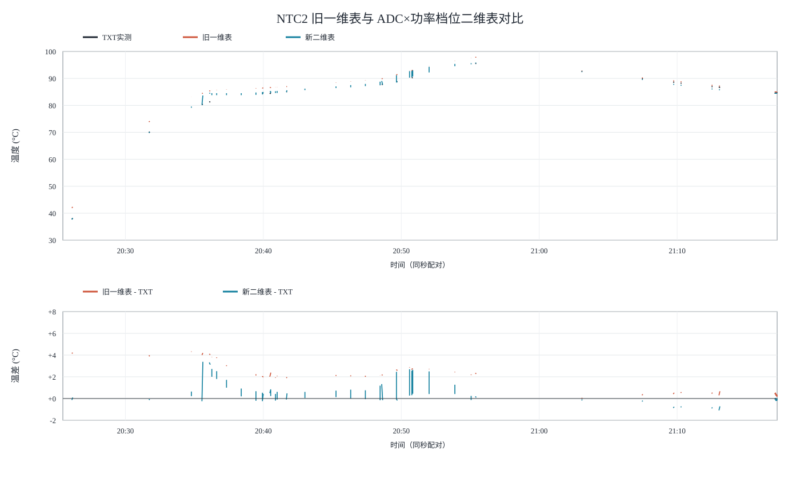

# NTC2 ADC × 功率档位二维标定报告

日期：2026-10-14

## 结果

从 `agent-tp/data/testdata/ntcdata/261014/231906.log` 按行流式恢复站2 NTC2 ADC，并从站1缓存区 `0x0200` 恢复站3加热状态/档位。提取 76,455 个 ADC 读数，CRC 错误 0；随后与外部温度 TXT 按同秒匹配。

以 2026-10-14 20:12:00～21:17:15 为标定窗口，共 428 个配对秒。按时间顺序、每5点留1点验证，旧一维表与二维表在相同 87 个留出点上的结果如下：

| 指标 | 旧一维表 | 新二维表 |
|---|---:|---:|
| MAE | 2.003℃ | 0.618℃ |
| RMSE | 2.550℃ | 0.914℃ |
| P95 绝对误差 | 4.365℃ | 2.150℃ |
| 最大绝对误差 | 7.500℃ | 3.131℃ |



上图使用全窗口拟合表展示曲线形状；表格误差指标来自另行留出的87个点。验证来自同一段时间序列，邻近点存在相关性，不能替代跨批次独立验证。

## 表格覆盖

表由 4 个档位锚点、共 49 个 ADC 节点组成。档位7/8/9的样本合并拟合为档位9锚点；运行时对 ADC 与档位分别线性插值。

| 档位锚点 | 配对秒数 | ADC 实测范围 | TXT 温度范围 |
|---:|---:|---:|---:|
| 0 | 299 | 1670.5～2187.0 | 76.5～96.0℃ |
| 9（含7/8/9） | 62 | 1677.2～2063.3 | 81.0～95.4℃ |
| 10 | 49 | 2069.7～2812.2 | 56.7～80.9℃ |
| 19 | 18 | 2920.3～3470.0 | 34.2～52.6℃ |

档位14及低档位1～6、11～18没有对应的独立标定锚点。相邻锚点 ADC 覆盖不重叠时，固件回退到旧一维表；因此这些档位/ADC 组合仍需补测，不应视作二维标定覆盖。原有一维表也作为运行时回退保留，NTC1表与接口不变。

## 复现与自测

```bash
python3 function/ntcTemp/extract_ntc2_adc.py agent-tp/data/testdata/ntcdata/261014/231906.log
python3 function/ntcTemp/calibrate_2d.py --write
gcc -std=c11 -Wall -Wextra -Wpedantic -Itask/DataCenter -Ifunction/ntcTemp \
	function/ntcTemp/ntcTemp.c function/ntcTemp/test_ntcTemp_2d.c -lm -o /tmp/test_ntcTemp_2d
/tmp/test_ntcTemp_2d
```

C 自测覆盖总开关关闭时 gear0、锚点查表、档位插值、档位14无覆盖回退和 ADC 范围判断，已通过。NTC 模块通过主机 GCC C11 严格语法检查。VS Code CMake Tools 无法配置当前工程，终端环境也没有 `cmake`，因此本次未完成 ESP-IDF 全量固件构建。