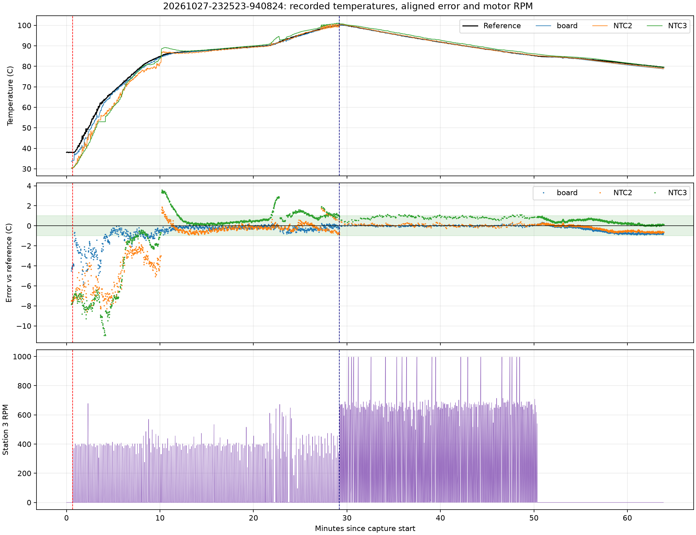
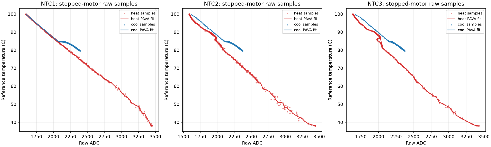

# 20261027-232523 温度拟合与稳定性分析

分析日期：2026-10-28。时间均按采集日志的本地时间（北京时间）解释。

## 1. 结论

**这次记录显示：NTC1对应的主温度在85℃以上升温和整个已记录降温段表现较好，降温曲线平稳、没有发现持续冻结；低温升温段仍有明显偏低及阶梯更新。不能概括为全温区都已经很准。**

- 85℃以上升温：主温度MAE为 **0.226℃**，P95绝对误差 **0.556℃**，最大绝对误差 **0.895℃**。
- 约100℃降至79.5℃：主温度MAE为 **0.378℃**，最大绝对误差 **0.890℃**；本次成功对齐的样本均在±1℃内。
- 60℃以下升温：主温度平均偏低 **2.871℃**，最差偏低 **5.869℃**。60～80℃仍平均偏低约1.11℃，应优先检查和补充低温升温标定及动态滞后。
- 原始ADC离线试拟合显示，NTC1的升温映射比NTC2/3更一致；三个通道的降温映射都较集中。但同一条曲线不能完全覆盖升降温过程，低于约85℃时两阶段仍存在明显分离。
- 电机恢复任务记录 **44次重发尝试**，全部针对电机1档，升温12次、降温32次。每次之后3秒内均有非零RPM反馈，未见持续堵转证据；这些触发不能直接等同于44次机械故障。

这是一批完整过程数据，不是恒温保持试验或跨批次重复性试验。当前可评价本次测温误差与过程平滑程度，不能据此宣布整机达到某个全工况精度等级。

## 2. 数据范围与处理口径

输入文件：

- `agent-tp/data/captures/2026-10-27/20261027-232523-940824.csv`
- 同名 `-serial.txt`，用于核对控制流程及恢复任务记录。

| 项目 | 数值 |
|---|---|
| 记录范围 | 2026-10-27 23:25:24.492～2026-10-28 00:29:18.748，约63分54秒 |
| CSV数据行 | 22,766 |
| 独立事件 | 参考温度2,548；主温度3,653；NTC原始ADC 3,298；三路NTC温度2,518；RPM 10,749 |
| 开始自动升温 | 23:26:02.858，模式由0转1；串口23:26:02.728记录校准完成 |
| 开始降温 | 23:54:35.812，参考温度100.1℃；串口记录超过100℃后关闭加热并启动冷却 |
| 冷却流程完成 | 次日00:15:46.712，参考温度≤85℃；随后继续记录自然降温至79.5℃ |

每种数据只使用自身事件行及自身接收时间，并去重时间戳，避免把其他事件中重复携带的旧快照当成新测量。主温度与三路NTC温度分别分析，误差定义为`测温值−参考温度`。

参考温度按测温接收时间线性插值；主统计要求前后参考点间隔≤2秒，不在缺口内强行补值，不在两端外插，不通过人为时间平移追求更小误差。启动阶段主温度为0，约23:25:56首次输出33.502℃，未将这些启动0值计入正常升降温精度。

CSV“本地MACHINE”全部为4，但 [Recorder实现](../../agent-tp/tools/soy_host/telemetry.py)将该值固定用于上位机本地拟合，明确不读取固件机型宏。因此本报告**不拿本地MACHINE=4判断固件机型，也不拿“NTC1/2本地拟合”列评估当前控制温度**。三路“查表温度”来自固件日志，已包含其运行时处理，并不是未经滤波的裸查表输出。

## 3. 当前主温度的准确度

### 3.1 升温分温区

按插值后的参考温度分组；最高温区包含100℃附近数据。

| 参考温区 | 有效点 | 平均偏差℃ | MAE℃ | P95绝对误差℃ | 最大绝对误差℃ |
|---|---:|---:|---:|---:|---:|
| 35～60℃ | 98 | −2.871 | 2.871 | 4.551 | 5.869 |
| 60～80℃ | 166 | −1.106 | 1.106 | 3.438 | 4.950 |
| 80～85℃ | 71 | −0.861 | 0.861 | 1.258 | 1.440 |
| 85～90℃ | 396 | −0.183 | 0.191 | 0.448 | 0.895 |
| 90～95℃ | 124 | −0.267 | 0.295 | 0.681 | 0.793 |
| 95℃至峰值附近 | 157 | −0.227 | 0.262 | 0.490 | 0.655 |

全升温段1,012个有效点，MAE为0.671℃。全段平均会掩盖低温误差；85℃以上677个点MAE为0.226℃，其中92.8%在±0.5℃内、100%在±1℃内。

最差点位于23:27:14.253，CSV物理第674行：主温度40.519℃，插值参考46.388℃，偏低5.869℃。它不是启动0值造成的假误差。

23:27:17.472～23:27:18.535，主温度从40.519℃跳到44.280℃，约1.06秒变化3.761℃。这更像有效温度恢复、表格/滤波状态变化或采样更新后的阶梯；仅凭日志不能确定具体原因，不能直接解释为液体瞬间升温3.761℃。

### 3.2 降温分温区

| 参考温区 | 有效点 | 平均偏差℃ | MAE℃ | P95绝对误差℃ | 最大绝对误差℃ |
|---|---:|---:|---:|---:|---:|
| 95℃至峰值附近 | 54 | +0.007 | 0.049 | 0.135 | 0.162 |
| 90～95℃ | 75 | +0.013 | 0.038 | 0.086 | 0.106 |
| 85～90℃ | 74 | +0.025 | 0.061 | 0.167 | 0.216 |
| 80～85℃ | 719 | −0.404 | 0.444 | 0.814 | 0.890 |
| 79.5～80℃ | 51 | −0.761 | 0.761 | 0.835 | 0.849 |

降温85℃以上贴合较好；降至80℃附近后出现平滑、持续的负偏差，属于准确度漂移，不是高频跳动。结尾参考约79.5℃，主温度约78.76℃，仍有约−0.74℃差异。下一轮降温表验证应重点看79～85℃，但不建议仅据此整体平移整张降温表。



图中红虚线为自动升温开始，蓝虚线为降温开始；`board`为主温度。误差使用散点，未跨参考采样缺口连线。温度总览为了展示整体过程连接相邻记录，不能将连接线看成缺口内的实测曲线。主温度与NTC1基本重合，因此总览未重复绘制NTC1。

## 4. 温度是否稳定、有没有冻结

温度在持续升降，不能用整段温度标准差代表测量噪声。本次对30秒分窗中的`主温度−参考温度`做线性去趋势，统计残差标准差；每窗至少10个有效点且跨度至少15秒。

| 指标 | 升温 | 降温 |
|---|---:|---:|
| 有效30秒窗数 | 57 | 28 |
| 窗内去趋势标准差中位数 | 0.131℃ | 0.042℃ |
| 窗内去趋势标准差P95 | 0.613℃ | 0.056℃ |
| 相邻0.5～1.5秒主温度变化P95 | 0.360℃ | 0.054℃ |
| 相邻0.5～1.5秒最大变化 | 3.761℃ | 0.173℃ |
| 上述相邻点变化>1℃次数 | 8 | 0 |

相邻变化使用全部正常阶段主温度事件，不要求参考点对齐；因此与残差分窗不是同一组样本。

在相邻记录间隔≤2秒的连续区间内，以变化≤0.001℃判为相同读数，未发现持续≥10秒的主温度平台。最长升温平台约9.52秒，最长降温平台约9.70秒。后者发生在峰值后的23:55:02附近，主温度约100.006℃，参考温度变化很小；没有“参考明显下降而主温度长期锁死”的证据。日志缺口内无法判断是否更新。

因此：**降温短时稳定性较好，低温升温则同时存在系统偏低和阶梯更新。** 降温残差约0.04℃不等于绝对精度±0.04℃，参考温度本身只以0.1℃记录，且还有位置、响应速度和时间对齐误差。

## 5. 三路NTC的比较

| 固件输出通道 | 升温全段MAE℃ | 升温≥80℃ MAE℃ | 降温全段MAE℃ | 降温平均偏差℃ |
|---|---:|---:|---:|---:|
| NTC1 | 0.690 | 0.302 | 0.387 | −0.345 |
| NTC2 | 1.931 | 0.712 | 0.294 | −0.210 |
| NTC3 | 2.266 | 0.942 | 0.487 | +0.486 |

NTC1升温表现最好，且与主温度非常接近。NTC2/3低温升温存在更大负偏差，NTC3在部分高温阶段还偏高。降温时三路都较平滑，但NTC3具有持续正偏，NTC1/2在低温尾段偏低。

不建议直接把三路平均作为改进方案：不同方向的偏差可能暂时抵消，也可能随工况一起漂移。应先分别确认通道标定和安装位置影响。

## 6. 本次原始ADC离线试拟合

### 6.1 样本筛选与方法

独立于现有表，按本次数据各自建立“升温一条曲线、降温一条曲线”的探索性拟合。没有向固件写入新表，也没有重放或复制其全部运行时滤波。

- 升降温阶段内原始NTC事件共3,261个。
- 要求最近RPM反馈距离ADC时间≤0.5秒，RPM连续为0至少0.5秒；相邻RPM反馈间隔>0.5秒重新计时。
- 1,940个点因未满足该门控剔除，126个点因参考时间对齐不合格剔除，最终保留 **1,195个三路样本**：升温692、降温503。
- 每32 ADC分箱，使用箱内ADC均值、参考温度中位数，按样本数加权做单调递减PAVA拟合，再线性插值。
- 回代误差使用建表样本；交错五折验证每5点留1点、轮换5次；连续时间块五折验证按时间分成5块，依次留一整块。
- 验证点必须在训练表ADC范围内，表外点不外插，也不通过端点钳位伪造覆盖。

### 6.2 结果

| 阶段/通道 | 样本/节点 | 建表回代MAE℃ | 交错五折MAE℃（有效点） | 连续时间块MAE℃（有效点） |
|---|---:|---:|---:|---:|
| 升温 NTC1 | 692/59 | 0.151 | 0.167（686） | 0.136（415） |
| 升温 NTC2 | 692/57 | 0.324 | 0.360（669） | 0.772（417） |
| 升温 NTC3 | 692/54 | 0.360 | 0.368（663） | 1.913（415） |
| 降温 NTC1 | 503/24 | 0.058 | 0.053（492） | 0.077（302） |
| 降温 NTC2 | 503/24 | 0.050 | 0.053（499） | 0.067（302） |
| 降温 NTC3 | 503/22 | 0.057 | 0.058（498） | 0.059（302） |

连续块验证仅覆盖约60%的点，主要因为留出头尾时间块会失去相应ADC范围。它与交错验证的测试点不同，不能因NTC1连续块MAE较低就认定其更容易泛化。它仍来自同一批运行，不是另一台机器或另一次实验。

这些结果支持以下判断：

1. **NTC1原始ADC与参考温度的升温关系较集中，现有低温偏差具有进一步改善标定/动态处理的空间。** 但新拟合使用了本批数据，不能把0.167℃直接当成更换表后的实机精度。
2. NTC2、尤其NTC3的升温连续块结果变差，提示相同时段以外的映射一致性更弱，需继续分工况或排查局部传热、滤波和采样条件，不能只看回代误差。
3. 三路降温曲线拟合都较集中。现有主温度在80℃附近仍偏低，说明“原始关系可拟合得好”和“当前整条运行时温度链已经准确”是两回事。
4. NTC1在85℃以上升降温曲线接近，低于约85℃逐渐分离；NTC2/3分离更明显。加强隔热后的这次数据仍不支持删除阶段区分、将升降温强行合表。



图中曲线使用全体入选样本建表，展示映射形状；验证指标来自各自另外训练的折内表。

## 7. 电机恢复与过程影响

串口共44条`Recover station 3 address=0x0004 target=1`，均为电机恢复；未发现加热通道恢复记录。其中升温12条、降温32条。

对每条记录向后找首个非零RPM反馈，44条均在3秒内出现，延迟中位数约0.24秒。它说明反馈随后恢复为非零，不证明每次都是恢复任务起效，也不证明此前发生了机械堵转：周期启动瞬间、停机尾部、异步反馈和命令排队都可能触发“目标非0但RPM为0”。

本次升温和冷却由上位机自动流程驱动，并非直接等同于固件`HeatSoyMilk()`完整制作流程。串口记录23:54:35超过100℃进入冷却、00:15:46降至85℃完成冷却，不能拿当前固件制作流程的89℃退出条件代替本次实际阶段。

温度与电机RPM有间歇变化，可能改变采样有效性及热混合。44次触发值得后续核查，但目前没有证据将低温偏差单独归因于电机恢复，也不能据此认定控制完全无异常。

## 8. 数据缺口与结论可靠性

参考温度有441个>2秒间隔，最长8.074秒。严格口径下主温度升温匹配1,012/1,625个正常事件，降温匹配973/1,991个事件，覆盖不是完整均匀采样；较长缺口主要影响阶段权重，不能忽略。

放宽允许插值间隔后：

| 参考最大间隔 | 升温有效点/MAE℃ | 降温有效点/MAE℃ | 降温最大绝对误差℃ |
|---|---:|---:|---:|
| 2秒，主统计 | 1,012/0.671 | 973/0.378 | 0.890 |
| 5秒，敏感性检查 | 1,616/0.717 | 1,616/0.248 | 0.890 |
| 10秒，敏感性检查 | 1,625/0.715 | 1,991/0.214 | 0.890 |

降温平均误差随允许缺口变化，主要因为新增点更多落在贴合较好的高温段。不同覆盖口径不能混为同一个精度指标；10秒插值也不能证明缺口内没有瞬态。总体“高温较准、降温平稳、低温升温偏低”的判断没有因此改变。

## 9. 下一步建议与复现

优先保留当前高温和降温表现，先补测38～80℃升温，核对40.519℃平台、档位切换及停机采样恢复，区分探头响应滞后、现有标定偏差和运行时保持旧值。用下一次完整实验作为独立验证，再决定是否更新NTC1升温表。

降温补测79～85℃，检查相同偏差是否重复出现。电机恢复应核对触发前的目标命令与RPM时间关系，再决定是否增加启动宽限；本次没有修改恢复控制。

可复现脚本：[analyze_thermal_run.py](../../script/analyze_thermal_run.py)。需Matplotlib；本次依赖位于被忽略的`build/analysis_deps`，绘图库缓存位于`build/matplotlib`。

```bash
PYTHONPATH=build/analysis_deps PYTHONDONTWRITEBYTECODE=1 \
python3 script/analyze_thermal_run.py \
  agent-tp/data/captures/2026-10-27/20261027-232523-940824.csv \
  --out-dir build/thermal_analysis
```

中间对齐数据、统计JSON和图形位于`build/thermal_analysis`；报告图副本保存在本目录。未更改生产标定表或固件代码。原始日志仍留在被忽略的`agent-tp/data/captures`，不加入版本控制。
