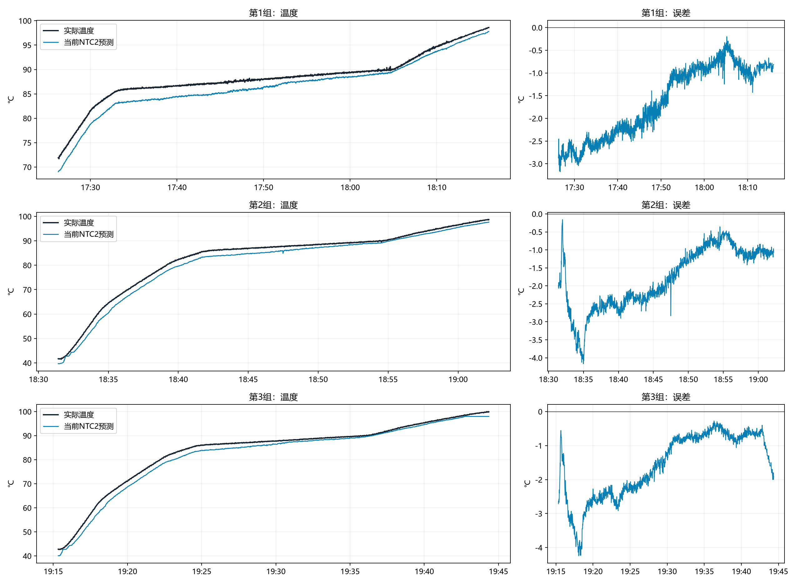

# NTC2 三次新数据分析（2026-10-12）

三次新数据重复性较好，但与旧表存在温区相关的系统偏差。建议根据新数据重新标定，而不是直接固定加温度。两组训练、一组验证的新表平均绝对误差为0.145～0.237℃；固定加约1.7℃为0.726～0.859℃。该结论仅覆盖本次新数据，尚未验证重标定表对旧数据的适用性。

本分析使用当前固件查表，NTC2 高温端返回98℃。未更新固件标定。TXT只保留0～150℃，按站2最近接收时间与TXT同秒配对，去重后同秒平均。各组NTC2独立保留，不按NTC1误差删除。所有4859个配对点的绝对误差均小于20℃，因此无需按该阈值剔除。

## 当前查表的验证结果

|对象|样本数|MAE ℃|RMSE ℃|平均偏差 ℃|P95绝对误差 ℃|最大绝对误差 ℃|
|---|---:|---:|---:|---:|---:|---:|
|第1组|2161|1.663|1.841|-1.663|2.848|3.176|
|第2组|1389|1.802|1.993|-1.802|3.248|4.167|
|第3组|1309|1.591|1.857|-1.591|3.266|4.243|
|三组合计|4859|1.684|1.890|-1.684|2.944|4.243|

负偏差表示预测温度低于真实温度。以上为旧查表验证误差，未在新数据上重新建表。

## 按实际温度分段（合并三组）

|对象|样本数|MAE ℃|RMSE ℃|平均偏差 ℃|P95绝对误差 ℃|最大绝对误差 ℃|
|---|---:|---:|---:|---:|---:|---:|
|40≤T<60|245|2.456|2.624|-2.456|3.676|3.974|
|60≤T<80|568|2.852|2.888|-2.852|3.937|4.243|
|80≤T<90|2908|1.719|1.858|-1.719|2.700|3.042|
|90≤T<98|986|0.808|0.842|-0.808|1.192|1.429|
|98≤T<151|152|1.083|1.148|-1.083|1.800|2.000|

## 三组留一验证：固定补偿与重新查表比较

每次只用另外两组计算固定补偿或查表，保留组不参与训练，不按验证误差删点。固定补偿为训练集真实温度减当前预测的平均值；新表使用32 ADC分箱与单调拟合，超范围按新表端点夹紧，不套用旧表98℃封顶。

|对象|样本数|MAE ℃|RMSE ℃|平均偏差 ℃|P95绝对误差 ℃|最大绝对误差 ℃|
|---|---:|---:|---:|---:|---:|---:|
|验证第1组：当前表|2161|1.663|1.841|-1.663|2.848|3.176|
|验证第1组：训练补偿+1.700℃|2161|0.726|0.791|0.037|1.205|1.501|
|验证第1组：两组重拟合表|2161|0.145|0.179|-0.122|0.349|0.666|
|验证第2组：当前表|1389|1.802|1.993|-1.802|3.248|4.167|
|验证第2组：训练补偿+1.636℃|1389|0.756|0.868|-0.166|1.611|2.531|
|验证第2组：两组重拟合表|1389|0.182|0.246|-0.037|0.455|1.300|
|验证第3组：当前表|1309|1.591|1.857|-1.591|3.266|4.243|
|验证第3组：训练补偿+1.718℃|1309|0.859|0.966|0.126|1.548|2.525|
|验证第3组：两组重拟合表|1309|0.237|0.304|0.109|0.500|1.400|

## 数据覆盖与限制

- 第1组：17:26:17～18:16:01；配对真实温度71.7～98.6℃；超出旧表ADC范围0个点。

- 第2组：18:31:25～19:02:12；配对真实温度41.5～98.7℃；超出旧表ADC范围0个点。

- 第3组：19:15:20～19:44:21；配对真实温度42.7～100.0℃；超出旧表ADC范围76个点。

- 三份CSV起始时间相同，包含累积历史；只使用各自TXT覆盖的对应时段，没有把重复CSV历史叠加为样本。

- 第1组TXT起始时间早于有效配对起点，未匹配数据不用于误差或拟合；TXT中最低32℃并不代表已经标定32℃。

- 之前桌面1/2同名原始日志已更新；旧报告的回代MAE约0.25℃、跨组验证MAE约0.46～0.53℃，只供历史统计比较。

- 当前表98℃封顶，因此不能反映第三组接近100℃的变化。

- 留一验证仅检验本次三组间重复性，不能保证旧数据或其他设备同样适用。

## 曲线图

黑色为真实温度，蓝色为当前表预测；右列为预测减真实。旧表ADC范围外的点保留并计入误差。

