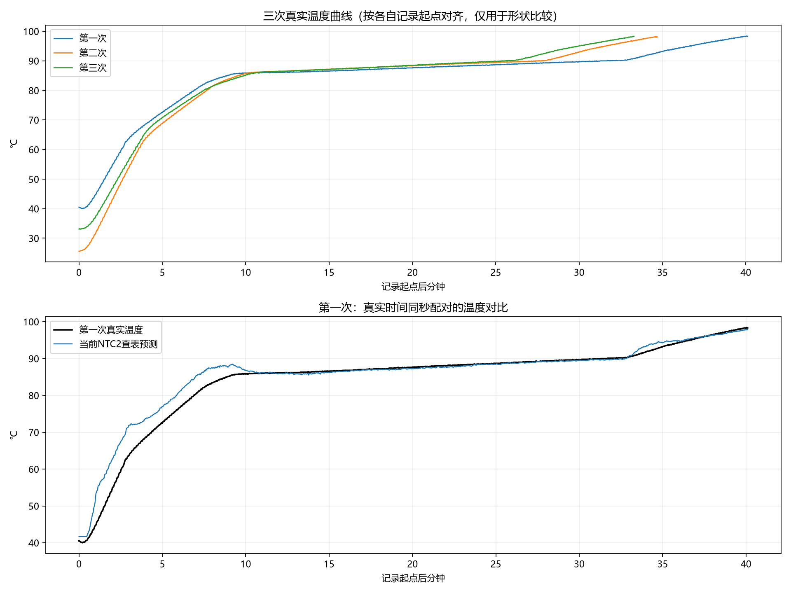

# 2号数据分析（仅分析，2026-10-13）

## 配对限制

三份CSV记录日期均为2026-10-12：15:37～16:19、16:20～18:37、20:31～21:30。只有第一次真实温度TXT（10月12日20:40～21:21）与第三份CSV重合。第二次为10月13日09:42～10:17，第三次为10月13日10:34～11:08，不能与前两份CSV按真实时间配对。不做时间平移。

每次两份TXT分别为真实温度T=记录和NB+SOYMODE控制日志，不是两路真实温度。TXT按GB18030解码，真实温度只保留0～150℃。

## 三次实际温度与模式阶段

### 第一次
有效真实温度1791条，范围40.0～98.4℃；无效记录614条；记录起止20:40:55.154～21:21:01.731。

|模式|开始时分秒|持续秒数|有效温度数|首→末真实温度 ℃|
|---|---|---:|---:|---|
|1|20:41:01.1|152.4|113|40.1→60.5|
|2|20:43:39.5|270.1|198|62.6→81.2|
|3|20:48:11.5|99.3|74|81.5→85.1|
|4|20:49:53.0|1406.4|1045|85.2→90.2|
|5|21:13:21.5|152.8|114|90.1→93.1|
|6|21:15:55.7|106.2|78|93.3→95.0|
|7|21:17:43.5|188.5|139|95.2→98.3|

### 第二次
有效真实温度1553条，范围25.6～98.2℃；无效记录527条；记录起止09:42:18.142～10:16:59.325。

|模式|开始时分秒|持续秒数|有效温度数|首→末真实温度 ℃|
|---|---|---:|---:|---|
|1|09:42:22.0|214.4|161|25.8→60.6|
|2|09:45:58.5|250.5|182|61.7→80.8|
|3|09:50:10.3|8.6|6|81.1→81.3|
|2|09:50:23.2|12.5|9|81.8→82.3|
|3|09:50:39.3|79.2|59|82.6→85.2|
|4|09:52:01.6|1071.8|799|85.4→90.0|
|5|10:09:54.5|154.2|114|90.0→93.1|
|6|10:12:30.5|83.9|62|93.4→95.0|
|7|10:13:55.6|173.0|129|95.2→98.1|

### 第三次
有效真实温度1496条，范围33.1～98.3℃；无效记录501条；记录起止10:34:32.364～11:07:49.832。

|模式|开始时分秒|持续秒数|有效温度数|首→末真实温度 ℃|
|---|---|---:|---:|---|
|1|10:34:42.8|220.6|164|33.3→64.6|
|2|10:38:24.8|222.2|166|65.3→80.4|
|3|10:42:16.5|134.6|101|80.8→85.1|
|4|10:44:32.2|956.5|711|85.3→90.1|
|5|11:00:29.9|143.5|107|90.1→93.1|
|6|11:02:54.9|110.4|82|93.2→95.2|
|7|11:04:46.4|178.4|132|95.3→98.1|

## 第一次：当前NTC2表对照真实温度

按站2最近接收时间与TXT同秒配对、重复快照去重，同秒取均值。使用现有表并保留98℃封顶，不更新标定。

n=1787, MAE=1.453℃, RMSE=2.632℃, 偏差=+1.140℃, P95=7.536℃, 最大=9.342℃, >1℃=527, >20℃=0

配对真实温度40.0～98.4℃；超出查表ADC范围22个。

- 0≤T<41.7℃：n=29, MAE=1.425℃, RMSE=1.440℃, 偏差=+1.425℃, P95=1.700℃, 最大=1.842℃, >1℃=29, >20℃=0

- 41.7≤T<60℃：n=83, MAE=7.497℃, RMSE=7.664℃, 偏差=+7.497℃, P95=8.847℃, 最大=9.342℃, >1℃=83, >20℃=0

- 60≤T<80℃：n=193, MAE=5.126℃, RMSE=5.287℃, 偏差=+5.126℃, P95=7.788℃, 最大=8.294℃, >1℃=193, >20℃=0

- 80≤T<90℃：n=1087, MAE=0.654℃, RMSE=1.293℃, 偏差=+0.252℃, P95=3.842℃, 最大=4.905℃, >1℃=138, >20℃=0

- 90≤T<97.9℃：n=364, MAE=0.597℃, RMSE=0.783℃, 偏差=+0.342℃, P95=1.593℃, 最大=1.805℃, >1℃=84, >20℃=0

- 97.9≤T<151℃：n=31, MAE=0.494℃, RMSE=0.497℃, 偏差=-0.494℃, P95=0.557℃, 最大=0.622℃, >1℃=0, >20℃=0

## 说明

模式阶段来自发送命令的时间，不等同于执行器反馈；温度记录起点及初始温度不同，三条曲线不代表相同起始条件。前三个CSV无法组成三次一一对应的误差验证，需提供10月13日上午对应CSV。

