# UI 操作指南

第一次使用，从“30 秒上手”开始；查某个页面，可以直接使用下方目录。屏幕是英文，本指南同时给出英文名称和中文操作说明。

适用版本：2026-11-09 当前工程 UI，覆盖全部 **30 个逻辑页面**，以及首页设置入口、配网与升级入口。配图由当前源码的真实 LVGL 渲染生成，已转为正常阅读方向；它们是页面示例，不是本次设备实拍，数值和高亮会随实际选择变化。

**当前工程默认使用演示模式：检查项可模拟通过，制作约 5 秒后跳完成页，停止约等待 2 秒。演示完成不代表真实食物已经制作完成。使用实机正常版时，应按真实安装状态和工艺完成提示操作。**

## 目录

- [30 秒上手与通用操作](#quick-start)
- [首页：选择功能](#home)
- [豆腐：从选软硬到取料](#tofu)
- [植物奶：配方、参数、制作与完成](#milk)
- [清洗：冲洗、深度清洗与停止](#clean)
- [配网与升级](#network)
- [常见问题与英文速查](#help)
- [当前版本说明与页面索引](#version)

## 30 秒上手

1. **转动旋钮**：把橙色边框或高亮移到要操作的项目。
2. **短按旋钮**：进入功能、执行按钮，或开始编辑参数。
3. **编辑参数时转动旋钮**：改变当前值；再次短按，结束编辑，再去选其他项目。
4. **返回上一页**：转到屏幕右上角的 **Back**，短按。不要把长按当作通用返回键。
5. **开始制作**：完成原料准备和安装检查，在最后的 **Start Making** 上短按。前面的 **Continue** 只是继续准备。
6. **中途停止**：短按 **Stop** 打开确认页，再选择停止并短按；进入 **Stopping...** 后等待，不要连续按键。

| 你的动作 | 界面反应 | 记住这一点 |
| --- | --- | --- |
| 正向旋转 | 下一项；编辑数值时增大 | 跟随橙色高亮判断当前选择 |
| 反向旋转 | 上一项；编辑数值时减小 | 开关和枚举项会在可选值之间切换 |
| 短按一次 | 执行当前高亮项 | 参数通常需要“短按进入编辑 → 旋转 → 再短按结束” |
| 看到左右箭头 | 正在编辑该参数 | 此时转动改变数值，不是在选择别的按钮 |
| 按钮变灰、选不中 | 条件未满足或正在等待停止 | 先处理安装提示，或等待任务结束 |
| 长按约 2 秒 | 不是通用返回或急停 | 当前制作中、停止确认中和停止等待中通常会忽略长按 |

首页、豆腐软硬度圆盘、植物奶配方圆盘和清洗模式圆盘可以循环选择；带 Back 的圆盘也会把 Back 纳入选择。普通参数、流程按钮在首尾停止，继续同方向旋转不会绕回。

### 三条最常用路线

| 想做什么 | 操作路线 |
| --- | --- |
| 做豆腐 | 首页 Tofu Studio → 软硬度 → 参数 → 加料 → 机器检查 → 安装压制组件 → Start Making → 制作完成 → Collect Pulp 或 Clean |
| 做植物奶 | 首页 Plant Milk → 配方 → 参数 → 加料 → 机器检查 → Start Making → 完成 → 取杯、处理豆渣 → Clean |
| 清洗 | 首页 Clean → Rinse 或 Deep Clean → 按提示准备 → Start Rinsing / Start Cleaning → 完成 → Done |

**停止确认页不是暂停页。** 在确认之前，原工艺仍可能继续运行；选择 Keep Making / Continue 只是关闭确认页，回到运行画面。

## 首页：选择功能

### P01 · 首页 Home

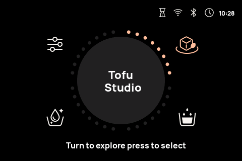

转动旋钮，中央名称和周围的橙色图标会随选择改变；短按进入当前功能。

| 屏幕名称 | 中文含义 | 短按后 |
| --- | --- | --- |
| Tofu Studio | 豆腐制作 | 进入 P02 软硬度选择 |
| Plant Milk | 植物奶 | 进入 P13 配方选择 |
| Clean | 清洗 | 进入 P23 清洗模式选择 |
| Settings | 设置 | 当前版本尚未接入设置页面；短按仍停在首页 |

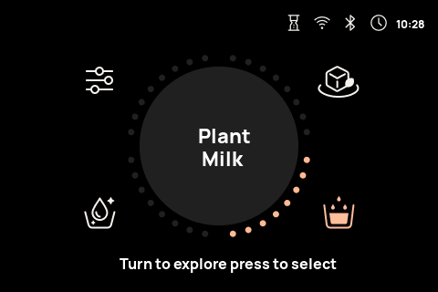

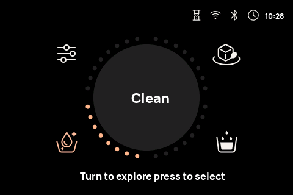

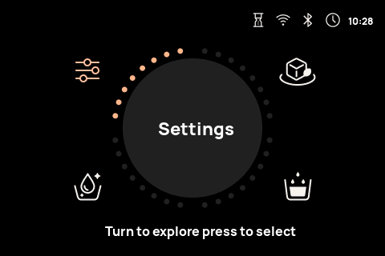

首页时间和状态图标包含展示元素，不应只凭图标判断设备已经联网；联网结果请看配网页的连接状态。

## 豆腐：从选软硬到取料

准备路线：**P02 → P03 → P05 → P06 → P07 → P08**。P04“更多选项”是从 P03 进入后再返回的可选步骤。

完成路线：**P08 → P09**。停止路线：**P08 → P10 → P11 → P12**。

### P02 · 软硬度选择 Tofu Firmness

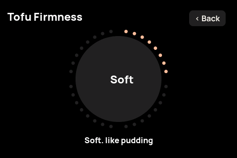

旋转选择软硬度，短按进入 P03 参数页；选中 Back 后短按返回首页。

| 名称 | 含义 | 页面说明 |
| --- | --- | --- |
| Soft | 嫩豆腐 | Soft, like pudding，口感较软 |
| Medium Firm | 中等硬度 | Smooth and holds its shape |
| Firm | 硬豆腐 | Dense and easy to slice |
| Extra Firm | 更硬 | Very dense and chewy |

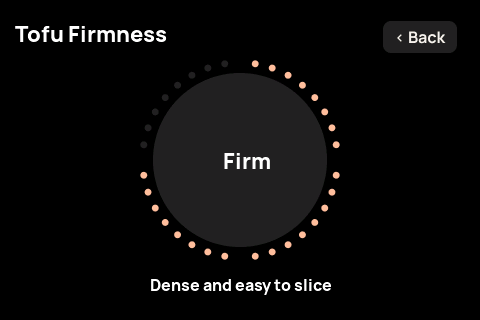

这四种选择共用后面的准备和停止流程。实际成品质地是否随此选择变化，见文末“当前版本说明”。

### P03 · 豆腐参数页 Soft / Medium Firm / Firm / Extra Firm Tofu

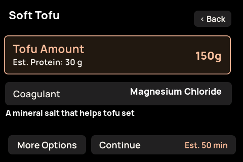

刚进入时默认选中 **Tofu Amount**。旋转按顺序选择：Back → Tofu Amount → Coagulant → More Options → Continue。

| 项目 | 如何操作 | 可选内容或去向 |
| --- | --- | --- |
| Tofu Amount | 短按进入编辑，旋转选值，再短按结束 | 100g / 150g / 200g，到边界停止 |
| Coagulant | 短按进入编辑，旋转切换，再短按结束 | Magnesium Chloride（氯化镁）/ Citric Acid（柠檬酸），循环切换 |
| More Options | 选中后短按 | 进入 P04 更多选项 |
| Continue | 选中后短按 | 进入 P05 加料，不会立即制作 |
| Back | 选中后短按 | 返回 P02 |

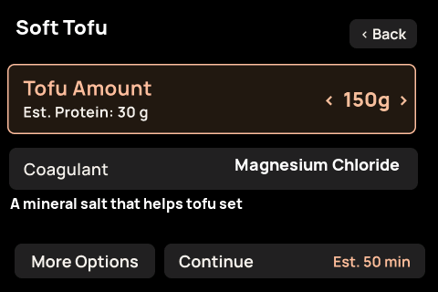

参数改变后会立即保留在当前 UI 会话中；Back 不会自动撤销刚才的修改。页面上的预计时间是提示，不是“此时已经开始制作”。

### P04 · 更多选项 More Options

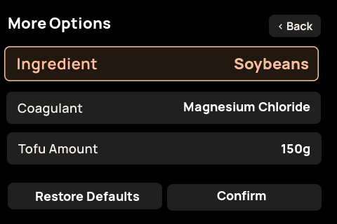

旋转选择项目，短按进入或退出编辑。Ingredient 可在 **Soybeans（大豆）**与 **PlantMilk（植物奶）**之间循环；Coagulant 和 Tofu Amount 与 P03 共用同一组选择。

| 按钮 | 操作结果 |
| --- | --- |
| Restore Defaults | 恢复配料为 Soybeans、用量 150g、凝固剂 Magnesium Chloride，并退出编辑；软硬度选择保持原值 |
| Confirm | 返回 P03，保留当前参数 |
| Back | 返回 P03；也会保留当前参数，不是撤销键 |

旋转只能在编辑结束后移动到其他项目；若一直改数值却选不到 Confirm，请先再短按一次。

### P05 · 加料 Add ingredients

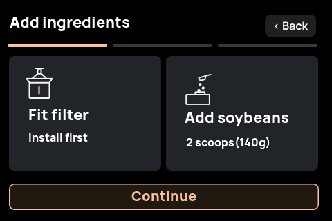

先按提示安装滤网，再添加原料。**Continue** 进入 P06 机器检查，**Back** 返回 P03 参数页；正转选 Continue，反转选 Back。

当前加料页的勺数、克数显示尚未与所有用量和配料选择统一，不应把示例重量当成已经确认的配方。实物加料按该设备已确认的配方执行。

### P06 · 机器检查 Check the machine

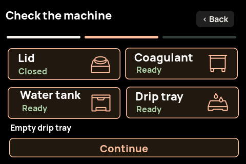

依次检查下列四项。正常模式下，全部通过才可选择 **Continue**；短按后进入 P07，并不会启动制作。

| 屏幕项目 | 需要做什么 | 通过后的常见显示 |
| --- | --- | --- |
| Lid | 关闭上盖 | Closed |
| Coagulant | 放好点卤盒；若提示 Add coagulant，补充凝固剂 | Ready |
| Water tank | 放好清水箱，按制作要求准备水 | Ready |
| Drip tray | 放好并清空黄水盒/废水盒 | Ready |

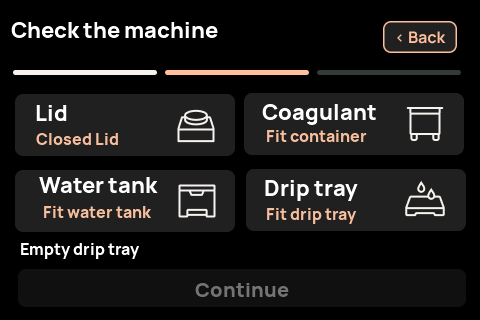

若显示 Fit container / Fit water tank / Fit drip tray，先重新安装对应部件；未通过时焦点会退回 Back。通信未就绪或传感器数据过期，也可能表现为未在位。Back 返回 P05。

### P07 · 安装压制组件 Fit the parts

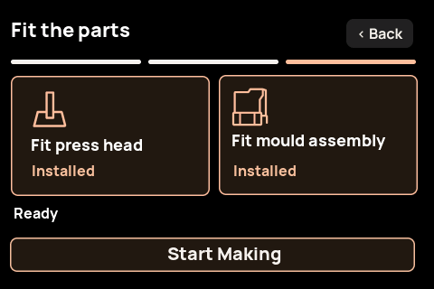

按顺序 **先安装压头 Fit press head，再安装模具组件 Fit mould assembly**。两项满足后，选中 **Start Making** 并短按，才进入 P08 制作；Back 返回 P06。

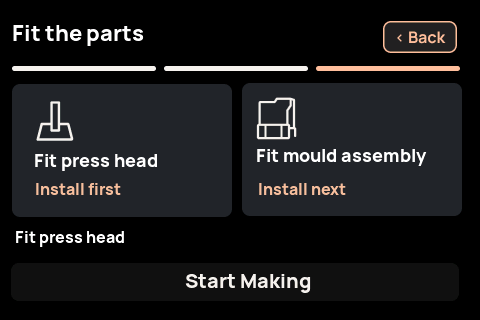

出现 Install first 表示先装压头；出现 Install next 表示下一步装模具；若提示 Remove press chamber. Fit press head first，按提示先处理安装顺序。

当前版本的模具/压制通道状态可以被配置为默认通过，所以画面显示 Installed 也应核对实物确实已装好。

### P08 · 豆腐制作中 Making tofu

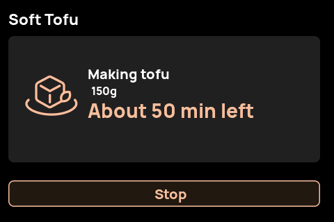

等待制作结束，系统会自动进入 P09。页面显示当前软硬度、用量和预计剩余时间；预计时间不等于精确倒计时。

需要结束本批次时，短按底部 **Stop**，进入 P10 确认页。旋转不会改变制作参数，长按不会作为停止指令。

### P09 · 豆腐完成 Tofu is ready

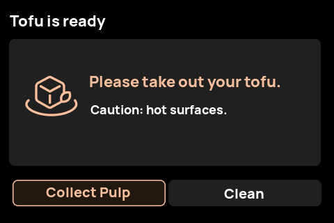

反转选择 **Collect Pulp**，正转选择 **Clean**，再短按确认。

| 按钮 | 正常模式的行为 | 下一步 |
| --- | --- | --- |
| Collect Pulp | 发起取料收尾动作，包括升降和压头动作；动作期间旋钮输入被锁定 | 等待动作完成，界面自动返回首页，再取料或从首页进入清洗 |
| Clean | 进入 P25 深度清洗准备页 | 按准备提示操作，再单独选择 Start Cleaning |

进入此页本身不会自动开始取料升降。点击 Collect Pulp 后保持部件就位，等待动作结束；若仍停留此页，可能是当前忙或取料任务未被接受，不能仅凭一次按键认为动作已完成。演示模式下 Collect Pulp 直接返回首页，不执行这些动作。

### P10 · 停止豆腐确认 Stop making tofu?

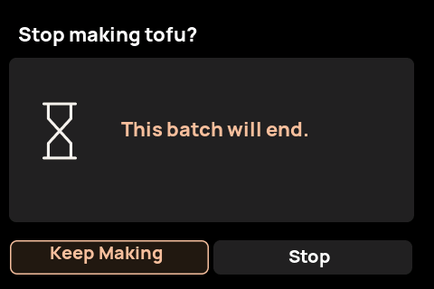

每次进入默认选中 **Keep Making**：短按返回 P08，继续当前批次。要结束本批次，正转选择 **Stop** 后再短按；正常进入 P11 等待停止。

**本页不会暂停工艺。** 未确认停止时，制作仍可自然完成并进入 P09。两个按钮到边界停止，不会循环绕回。

### P11 · 豆腐停止中 Stopping...

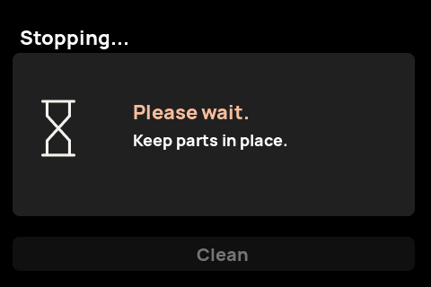

此时只需等待，保持部件安装。**Clean 禁用**，旋转和短按不会启动清洗；任务结束后自动进入 P12。

### P12 · 豆腐已停止 Making stopped

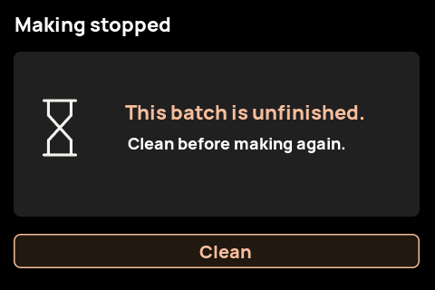

本批次未完成。短按 **Clean** 进入 P25 深度清洗准备页；准备完成后还要再按 **Start Cleaning**，不会在此处直接启动清洗。

## 植物奶：配方、参数、制作与完成

制作路线：**P13 → P14 → P15 → P16 → P17 → P18 或 P19**。停止路线：**P17 → P20 → P21 → P22**。

### P13 · 配方选择 Plant Milk

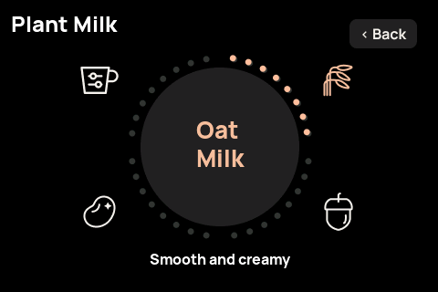

转动圆盘，在 **Oat Milk → Nut Milk → Soy Milk → Custom Milk → Back** 之间循环；短按配方进入 P14，短按 Back 返回首页。

| 名称 | 含义 | 页面原料提示 |
| --- | --- | --- |
| Oat Milk | 燕麦奶 | Add instant oats |
| Nut Milk | 坚果奶 | Add nuts |
| Soy Milk | 豆浆 | Add soybeans |
| Custom Milk | 自定义植物奶 | Add ingredients |

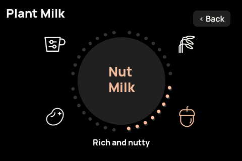

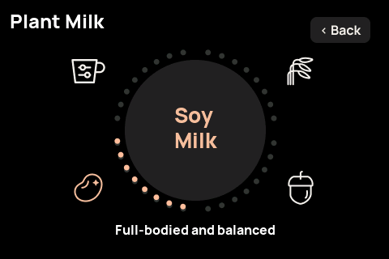

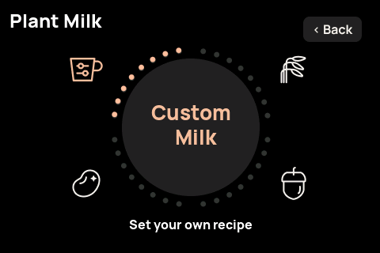

每种配方分别保留当前会话的 UI 参数。返回选择页后，会退出参数编辑并保留当前配方；这不是持久保存到下次开机的承诺。

### P14 · 植物奶参数页

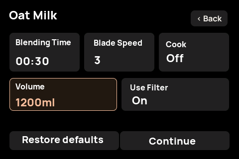

进入时默认选中 **Volume**。旋转选择项目，短按进入编辑，旋转调整，再短按结束编辑。

| 项目 | 中文 | 可调范围 | 初始默认值 |
| --- | --- | --- | --- |
| Blending Time | 搅拌时间 | 00:30～03:00，每步 15 秒 | 00:30 |
| Blade Speed | 刀片速度档位 | 1～5，每步 1 档 | 3 |
| Cook | 加热 | On / Off；Soy Milk 固定 On | Soy 为 On，其余为 Off |
| Volume | 容量 | 400～1200 ml，每步 100 ml | 1200 ml |
| Use Filter | 使用滤网 | On / Off | On |

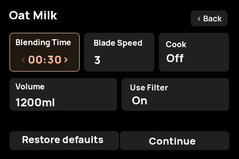

正向选择顺序是 Back → Blending Time → Blade Speed → Cook → Volume → Use Filter → Restore defaults → Continue。数值到边界后不再增加或减少；On/Off 每次有效转动切换。

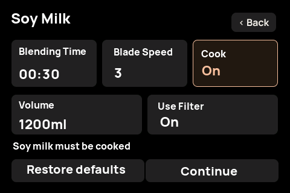

Soy Milk 的 Cook 可以被选中，但不能进入编辑或关闭。选择 Restore defaults 恢复**当前配方**的默认值；Continue 进入 P15；Back 返回 P13。当前这些参数的实际工艺接入范围见文末版本说明。

### P15 · 植物奶加料页

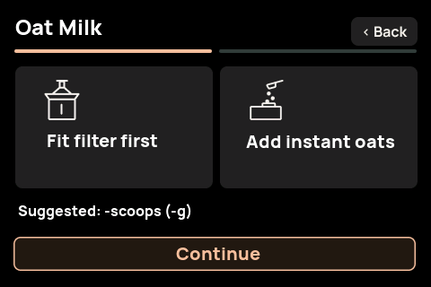

Use Filter 为 On 时先安装滤网；为 Off 时显示 **No filter required**。然后按所选配方添加原料。

正转选择 **Continue**，短按进入 P16；反转选择 **Back**，短按返回 P14。这里的 Continue 不会启动制作。Suggested 中的勺数和克数目前是占位提示，按已经确认的设备配方准备原料。

### P16 · 植物奶机器检查页

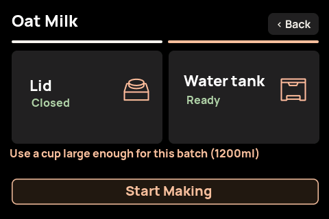

关闭上盖，放好清水箱，并提前在出料位置准备容量足够的杯子；页面会提示本批次设置容量，例如 1200 ml。

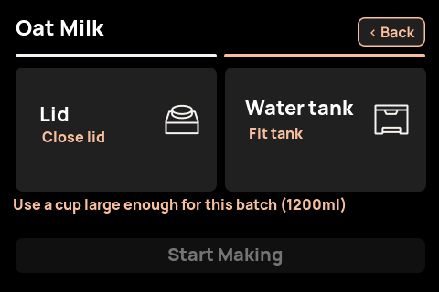

正常模式需要 Lid 为 Closed、Water tank 为 Ready，且设备任务空闲，才能短按 **Start Making** 进入 P17。未通过时按钮灰显、焦点退到 Back；Back 返回 P15。

### P17 · 植物奶制作中 Making Plant Milk

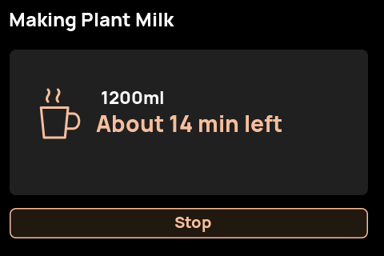

等待自然完成。Use Filter 为 On 时进入 P18，为 Off 时进入 P19。页面的容量和剩余时间用于显示；结束时刻以任务完成为准。

短按 **Stop** 打开 P20 停止确认页；长按不会代替停止确认操作。

### P18 · 植物奶完成：使用滤网 Milk is ready

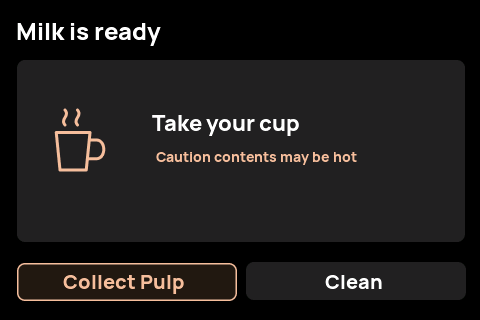

先按提示取杯，留意内容物可能很热。旋转选择以下按钮并短按：

| 按钮 | 当前行为 |
| --- | --- |
| Collect Pulp | 进入 P19“收集后/无滤网完成页”；当前没有连接自动收集豆渣执行器，不会因为按下此键而自动动作 |
| Clean | 直接进入 P25 深度清洗准备页，尚未启动清洗 |

植物奶的 Collect Pulp 与豆腐完成页中的同名按钮行为不同。处理滤网和豆渣需结合实物完成，不能把页面切换当成自动取渣完成。

### P19 · 植物奶完成：无滤网或已收集豆渣

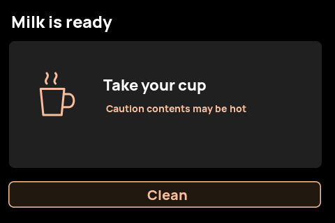

此页只有 **Clean**。短按进入 P25 深度清洗准备页；先按提示清理和准备，再按 Start Cleaning。

### P20 · 停止植物奶确认 Stop making milk?

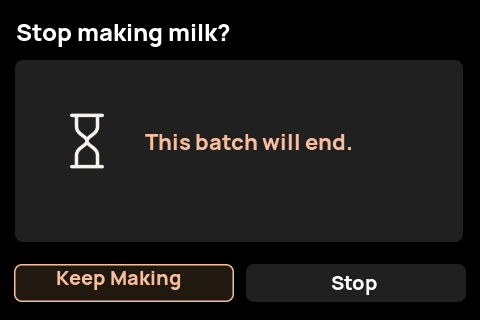

默认选中 **Keep Making**，短按返回 P17。需要结束本批次时，正转选 **Stop** 并短按，进入 P21；若任务已经停止，可能直接进入 P22。

此页不暂停制作；若制作在确认期间自然完成，会转到相应完成页。

### P21 · 植物奶停止中 Stopping...

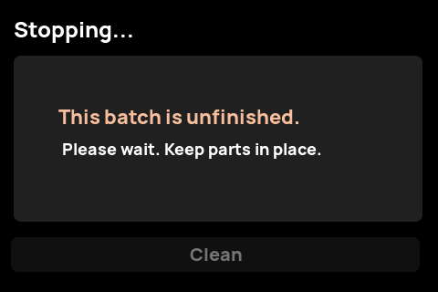

等待任务真正停止，保持部件就位。Clean 禁用，本页不接受短按操作；结束后自动进入 P22。

### P22 · 植物奶已停止 Making stopped

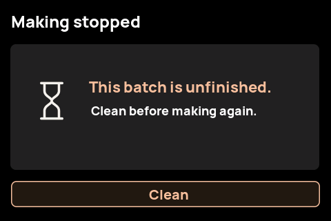

本批次未完成。短按 **Clean** 进入 P25 深度清洗准备页；此操作只打开准备页，不直接启动清洗。

## 清洗：冲洗、深度清洗与停止

冲洗路线：**P23 → P24 → P26 → P28**。

深度清洗路线：**P23 → P25 → P27 → P28**。制作完成或停止页的 Clean 也会直接进入 P25。

中途停止：**P26/P27 → P29 → P30 → P23**。

### P23 · 清洗模式选择 Clean

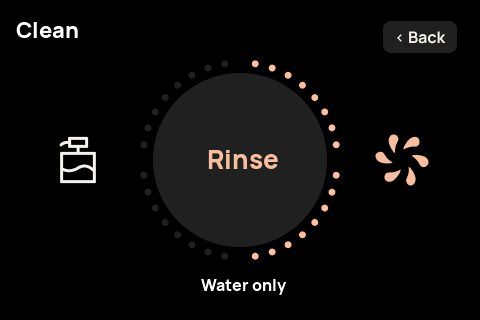

旋转在 **Rinse → Deep Clean → Back** 之间循环，短按进入：

| 模式 | 含义 | 下一页 |
| --- | --- | --- |
| Rinse / Water only | 仅用水冲洗 | P24 |
| Deep Clean / With cleaning agent | 使用清洗剂的深度清洗 | P25 |
| Back | 返回 | 首页 |

模式名称会显示在圆盘中央。这里选择模式还不会开始运行。

### P24 · 冲洗准备 Prepare to rinse

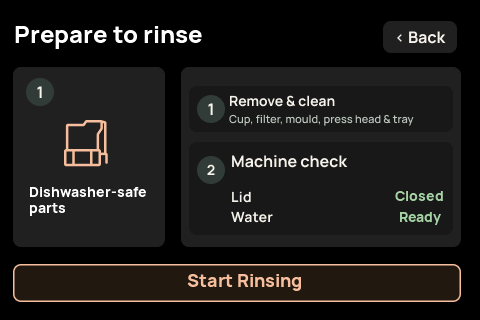

左侧提示约每秒自动切换，依次显示可拆洗部件、关闭盖子、安装水箱；不需要转动旋钮来翻这些提示。

按提示处理可拆洗部件，关闭上盖并准备、装好水箱。右侧 Lid 显示 Closed、Water 显示 Ready 后，正转选 **Start Rinsing** 并短按，进入 P26。反转选 Back，短按返回 P23。

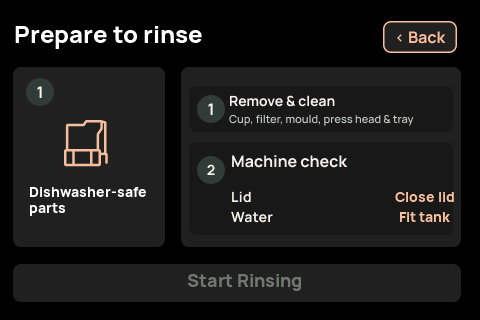

准备不足时不能启动，焦点会退到 Back。图片展示哪些部件可拆洗，不代表可以在清洗运行期间拆装。

### P25 · 深度清洗准备 Prepare to clean

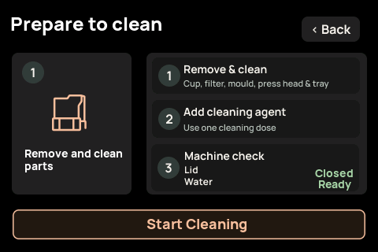

按轮播提示依次准备：**拆下并清理部件 → 添加设备适用的清洗剂 → 关闭上盖 → 安装水箱**。左侧示意约每秒轮换，右侧保留准备清单。

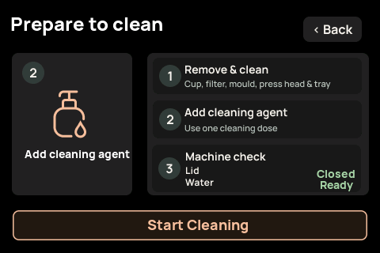

检查通过后，正转选择 **Start Cleaning**，短按才正式进入 P27；Back 返回 P23 清洗模式选择。清洗剂种类和用量按该设备已确认要求使用，页面未提供完整配比。

从豆腐或植物奶结果页按 Clean 进入本页时，同样要完成准备并再次确认启动。

### P26 · 冲洗中 Rinsing

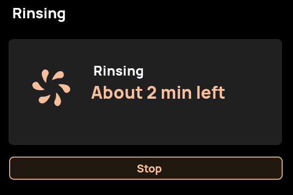

等待完成后自动进入 P28。页面预计约 2 分钟，仅用于显示，实际结束以任务状态为准。

需要中途结束时，短按 **Stop** 进入 P29，检查标题为 Stop rinsing?。

### P27 · 深度清洗中 Cleaning

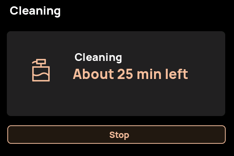

等待完成后自动进入 P28。页面预计约 25 分钟，仅用于显示；演示模式会提前模拟完成。

需要中途结束时，短按 **Stop** 进入 P29，检查标题为 Stop cleaning?。

### P28 · 清洗完成 Rinsing complete / Cleaning complete

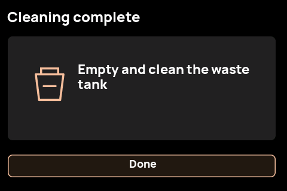

按屏幕提示 **Empty and clean the waste tank**，倒空并清洁黄水盒/废水箱。短按 **Done** 返回首页；转动旋钮不需要选择其他操作。

### P29 · 停止清洗确认 Stop rinsing? / Stop cleaning?

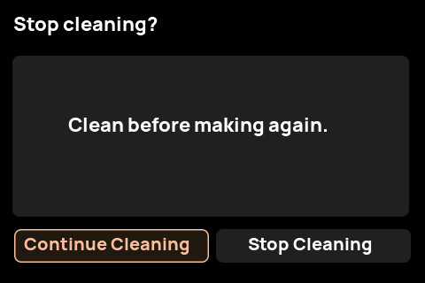

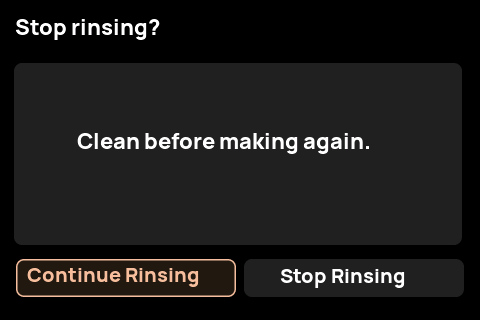

进入时默认选中 **Continue Rinsing / Continue Cleaning**。短按继续按钮返回对应运行页；正转选择 **Stop Rinsing / Stop Cleaning** 并短按，进入 P30。

此页也不会暂停清洗。确认停止前若已自然完成，会直接进入 P28。

### P30 · 清洗停止中 Stopping...

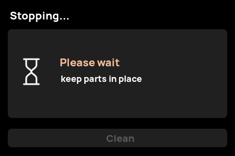

等待当前停止过程结束，保持部件就位。底部即使写着 **Clean**，也不是当前可执行按钮；旋转和短按不会重新启动清洗。

停止完成后，界面**返回 P23 清洗模式选择**，不会进入“清洗完成”。需要重新清洗时，重新选择模式并走准备流程。

## 配网与升级

这是旋钮的开机手势加手机网页操作，不在首页 Settings 中。

1. 上电后立即长按旋钮约 **5 秒**，并在开机前 **30 秒内完成**此动作。超过时间窗口后，普通长按不会打开配网；需要时重新上电再操作。
2. 在手机 Wi-Fi 列表中连接本机热点，名称形如 **NUVELL-XXXX**。当前热点为开放网络，无需输入热点密码；这与下一步的路由器密码是两回事。
3. 若手机没有自动打开页面，在浏览器输入 **http://172.27.231.1/**。
4. 在“连接 Wi-Fi”区域选择附近网络，或手动填写网络名称，输入路由器密码后按“连接”；使用设备支持的 2.4 GHz 网络。以页面显示“连接成功”和 IP 为准。
5. 如需升级，先按“检查新版本”查看结果；确认需要升级后，再按“检查并升级”。本次生成指南没有执行联网或升级。

| 网页位置 | 应如何理解 |
| --- | --- |
| 重新扫描附近网络 | 更新可选 Wi-Fi 列表 |
| 连接成功、配置已保存 | 设备已连接路由器并保存该配置 |
| 检查新版本 | 查询版本，区别于检查并升级 |
| 升级进度 | 保持供电，等待页面结果；主控升级成功会自动重启 |
| 下挂芯片镜像下载完成 | 仅表示镜像已经下载，不能据此认为低压板或高压板已经烧录成功 |

开机手势还会启动蓝牙配网入口，但当前没有可在 LCD 上操作的蓝牙设置页面，本指南不假定已存在某个配套手机 App。普通制作长按与该开机手势不是同一种操作。

## 常见问题

| 遇到的情况 | 处理方法 |
| --- | --- |
| 转动旋钮只改数字，选不到 Continue | 你还在编辑状态；再短按一次结束编辑，再旋转选按钮 |
| Back 在哪里 | 普通页通常在右上角；圆盘页继续转动也能选到 Back |
| Continue / Start Making / Start Cleaning 是灰的 | 检查盖子、所需容器或压制组件；正常模式还需要有效传感器数据和空闲任务 |
| 按 Continue 以后没有开始制作 | Continue 只是进入下一步准备；最后的 Start Making 才申请制作 |
| 停止确认打开后，机器还在工作 | 确认页不暂停；选中 Stop 并短按才申请结束 |
| Stop 后 Clean 按不了 | 正在停止；等到 Making stopped 或清洗模式选择页后再操作 |
| 按 Clean 后机器没开始清洗 | 它先打开深度清洗准备页；完成准备后再按 Start Cleaning |
| 植物奶 Collect Pulp 没有自动取渣 | 当前只做完成页切换，未接自动取渣动作 |
| 豆腐 Collect Pulp 后旋钮不响应 | 正常取料动作期间会锁定输入；等动作完成后自动回首页 |
| 只过约 5 秒就提示完成 | 设备可能使用演示模式，不能据此判断实物已经加工完成 |
| 选择 Settings 后没反应 | 当前尚未接入设置功能，属于预留入口 |
| 长按不返回，也不停机 | 当前长按不是通用返回或急停；返回选 Back，停止按界面确认流程操作 |

### 常用英文速查

| 英文 | 含义 / 用法 |
| --- | --- |
| Back | 返回上一页 |
| Continue | 继续下一步准备 |
| Start Making | 确认开始制作 |
| Keep Making | 保持当前制作，关闭停止确认 |
| Stop | 进入停止确认；确认页中则表示申请停止 |
| Stopping... | 正在停止，请等待 |
| Making stopped | 本批次已结束且未完成 |
| Ready / Closed / Installed | 准备就绪 / 已关闭 / 已安装 |
| Fit / Install | 安装对应部件 |
| Collect Pulp | 收集/取料入口；豆腐与植物奶中的行为见 P09、P18 |
| Clean / Deep Clean | 清洗入口 / 深度清洗 |
| Rinse | 冲洗 |
| Restore defaults | 恢复当前功能的默认参数 |
| Done | 完成并返回首页 |

## 当前版本说明

这些说明用于判断屏幕上的操作已经实现到什么程度：

- 本指南核对时，工程默认 `MYLVGL_UI_VALIDATION_MODE=1`：豆腐、植物奶和清洗使用模拟检查及约 5 秒制作、约 2 秒停止等待。刷入正常模式固件后，才按真实传感器和任务状态推进。没有新增一个让最终用户在屏幕上切换模式的菜单。
- 正常模式下，盖子和相关容器读取真实传感器；压制通道当前有默认通过设置。点卤低液位输入仍有预留接入条件，水箱高液位也不在这些页面的启动门控中，所以“页面通过”不能代替实际检查原料、水和部件。
- 植物奶 UI 的搅拌时间、速度、Cook、容量参数目前尚未完整传给实际执行工艺；执行层仍使用现有固定流程。Use Filter 会改变加料提示和完成页路线。不要把 UI 数值变化当成对应实际工艺已经改变。
- 豆腐软硬度、用量、凝固剂、配料已用于界面展示和选择；当前 UI 启动入口提交的是统一豆腐任务，本次未发现这些选择被作为工艺参数传入执行层。该版本不承诺选择变化必然改变实物配方或质地。
- 豆腐加料页勺数/重量、植物奶加料页 Suggested 提示、首页时间等存在示例或未统一内容。按设备已确认的配方操作；预计时间不是完成依据。
- 正常模式的豆腐 Collect Pulp 已接取料收尾动作；植物奶同名按钮尚未接自动取渣。这两处不能按相同效果理解。
- 本次做了主机操作回归及实际页面渲染，没有烧录设备或运行真实制作、清洗、配网、升级。图片便于认识界面，不能替代实机操作验收。

### 全部页面索引

P 编号为本指南的查阅编号，不显示在机器屏幕上。

| 编号 | 页面 | 主要操作 |
| --- | --- | --- |
| P01 | 首页 | 选豆腐、植物奶、清洗；设置预留 |
| P02 | 豆腐软硬度 | 旋转选软硬度，短按进入参数 |
| P03 | 豆腐参数 | 改用量、凝固剂，继续或打开更多选项 |
| P04 | 豆腐更多选项 | 改配料、用量、凝固剂，恢复默认或确认 |
| P05 | 豆腐加料 | 安装滤网、加料后 Continue |
| P06 | 豆腐机器检查 | 检查盖子、点卤盒、清水箱、黄水盒 |
| P07 | 压制组件检查 | 按顺序安装，最后 Start Making |
| P08 | 豆腐制作中 | 等待或 Stop |
| P09 | 豆腐完成 | Collect Pulp 或 Clean |
| P10 | 豆腐停止确认 | Keep Making 或 Stop |
| P11 | 豆腐停止中 | 等待，Clean 禁用 |
| P12 | 豆腐已停止 | Clean 进入深度清洗准备 |
| P13 | 植物奶配方 | 选四种配方或 Back |
| P14 | 植物奶参数 | 改参数、恢复当前配方默认值 |
| P15 | 植物奶加料 | 按滤网设置和原料提示准备 |
| P16 | 植物奶机器检查 | 检查盖子、水箱，准备杯子后 Start Making |
| P17 | 植物奶制作中 | 等待或 Stop |
| P18 | 有滤网完成 | Collect Pulp 切页，或 Clean |
| P19 | 无滤网/收集后完成 | Clean |
| P20 | 植物奶停止确认 | Keep Making 或 Stop |
| P21 | 植物奶停止中 | 等待，Clean 禁用 |
| P22 | 植物奶已停止 | Clean |
| P23 | 清洗模式 | Rinse / Deep Clean / Back |
| P24 | 冲洗准备 | 按提示准备，Start Rinsing |
| P25 | 深度清洗准备 | 按提示准备，Start Cleaning |
| P26 | 冲洗中 | 等待或 Stop |
| P27 | 深度清洗中 | 等待或 Stop |
| P28 | 清洗完成 | 清空废水箱，Done 返回首页 |
| P29 | 清洗停止确认 | Continue 或 Stop |
| P30 | 清洗停止中 | 等待后返回清洗模式选择 |

### 维护与来源

页面名称和操作以 [UI 页面定义](../function/UI/ui.h)、[旋钮与按键分发](../components/myLvgl/myLvgl.c)、[豆腐页面](../function/UI/Tofu)、[植物奶页面](../function/UI/PlantMilk)、[清洗页面](../function/UI/Clean)及当前流程桥接代码为依据。后续页面或按钮行为变化时应同步更新本指南。

配图、渲染记录和生成方法保存在 [UI 指南配图归档](../agent-tp/reports/ui-operation-guide/README.md)；辅助程序放在 `agent-tp/tools/ui-guide/`，临时构建及原始帧放在 `build/ccache/`。指南正文按用户指定位置放在 `docs/`。
