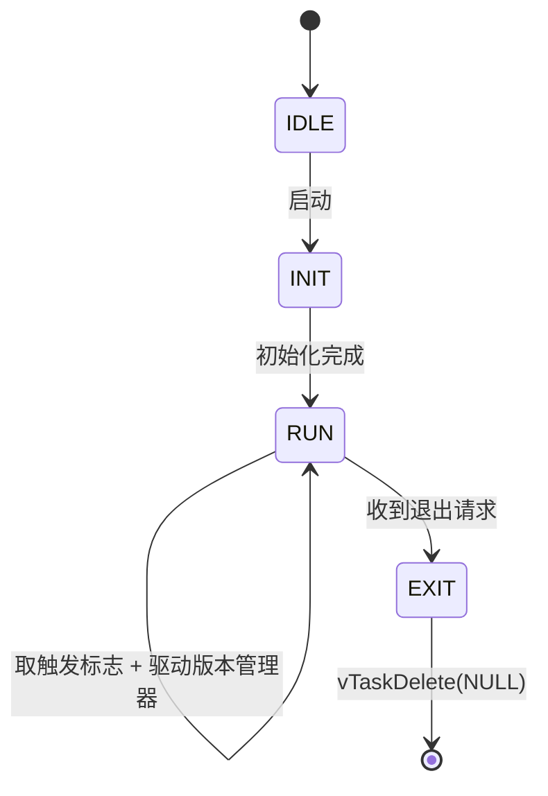
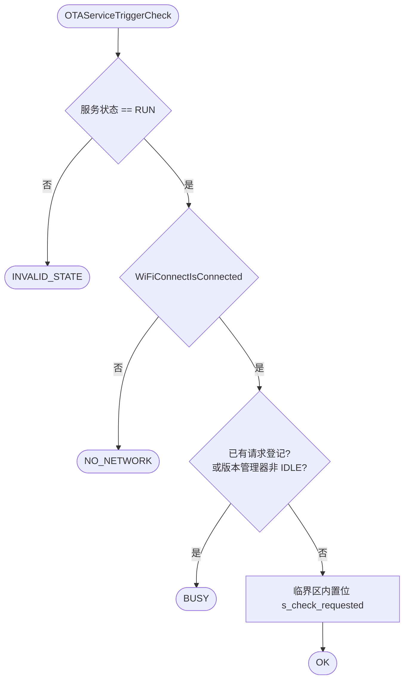
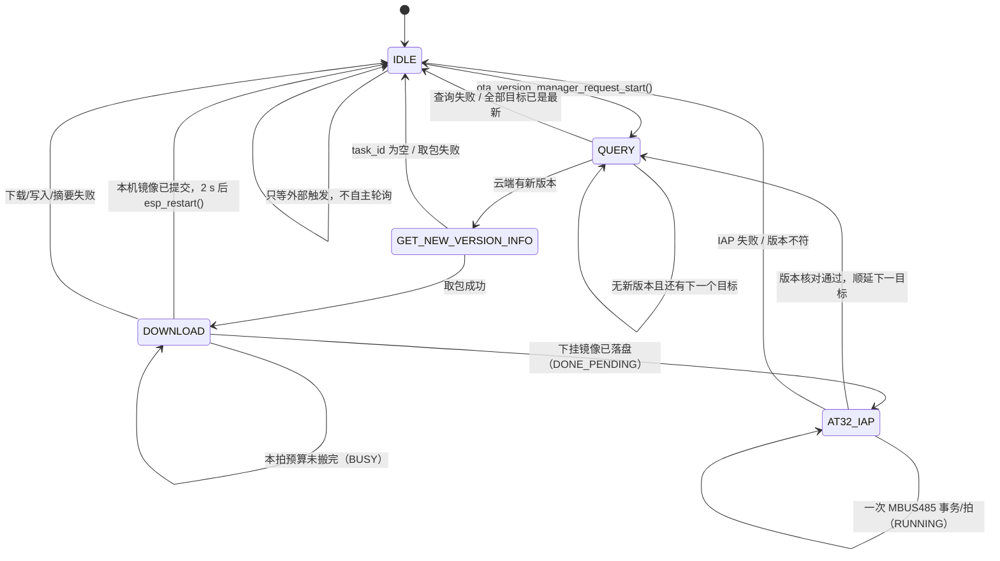
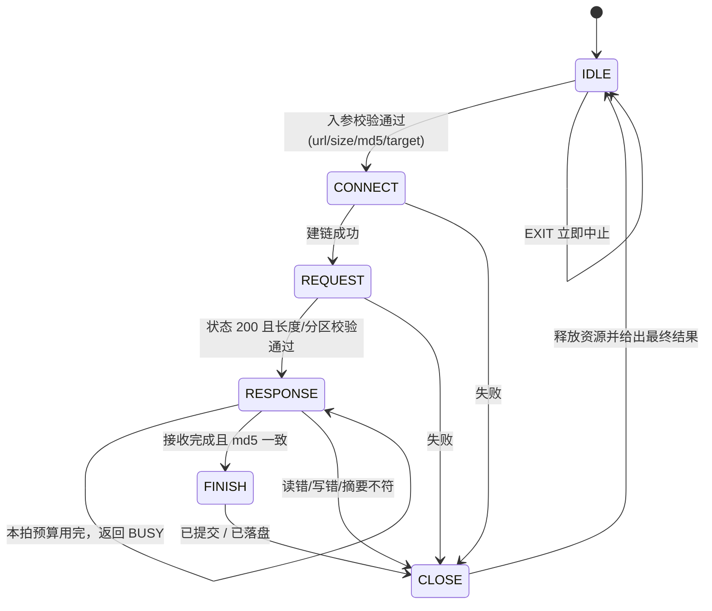
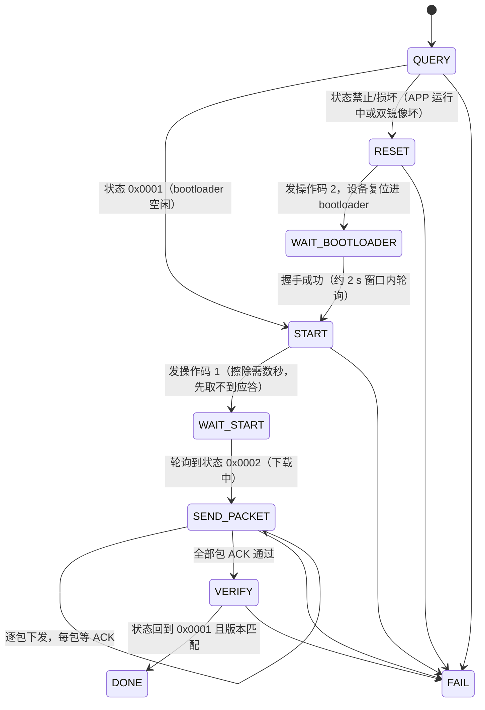

# OTAService 模块说明

本文只描述 `task/OTAService` 组件自身的功能，约定与用法；不涉及 `function/UI`、`task/DataCenter` 等其它模块的内部实现。

## 1. 一句话目标

为 ESP32-S3 本机固件与下挂芯片（AT32 / ST32）提供"联网检查云端版本 → 取包 → 分段下载 → 校验落盘 → 生效"的完整升级链路，并把这条链路收敛到单个 FreeRTOS 任务里串行执行，避免升级过程与业务任务抢占资源。

## 2. 非目标（本期不做）

- 不做定时/周期自动检查：状态机停在被动的 IDLE，只等外部显式触发。
- 不做 ST32 专用通道：ST32 与 AT32 除 Modbus 站号（0x02 / 0x03）与镜像分区
  （`AT_Firmware` / `ST_Firmware`）外协议一致，共用同一套 `OTAUart` / `OTAFrame`
  实现，见 [8. 下挂芯片 IAP 通道](#8-下挂芯片-iap-通道otauart--otaframe)。
- 不做升级进度/结果的对外上报接口（当前只有串口日志）。
- 不做云端查询的异步等待与超时：查询走同步 HTTP 事务，`WAIT_*` 两个状态为预留。

## 3. 文件构成与职责

| 文件 | 职责 |
|---|---|
| [OTAService.h](./OTAService.h) / [OTAService.c](./OTAService.c) | 任务骨架、服务级状态机、对外触发接口、本机固件版本字符串 |
| [OTAVerManager.h](./OTAVerManager.h) / [OTAVerManager.c](./OTAVerManager.c) | 一轮检查的状态机、云端"查版本/取包"HTTP 接口、下载目标选择 |
| [OTANetUpgrade.h](./OTANetUpgrade.h) / [OTANetUpgrade.c](./OTANetUpgrade.c) | HTTP 通道固件下载、分片写入、md5 校验、启动分区切换 |
| [OTAInfo.h](./OTAInfo.h) / [OTAInfo.c](./OTAInfo.c) | `OTA_Info` 分区内"某颗芯片已落盘到哪个版本"记录的读写 |
| [OTAUart.h](./OTAUart.h) / [OTAUart.c](./OTAUart.c) | 下挂芯片的 IAP 通道：经 MBUS485 把 `AT_Firmware` / `ST_Firmware` 内的镜像推给对应 bootloader（站号 0x02 / 0x03），管理会话状态机与收发，并核对实读版本 |
| [OTAFrame.h](./OTAFrame.h) / [OTAFrame.c](./OTAFrame.c) | 下挂芯片 IAP 的帧编解码组件：查询/控制/数据帧组帧，应答帧解帧，CRC16/CRC32 计算；站号由入参传入；纯函数、无状态、不做 IO，只由 `OTAUart` 调用 |
| [CMakeLists.txt](./CMakeLists.txt) | 组件注册：`REQUIRES OTA freertos WiFiConnect`，`PRIV_REQUIRES esp_http_client cjson app_update esp_partition DataCenter` |

依赖关系：

```text
main.c ──创建──> OTAServiceTask
                     │ 每 100 ms 驱动
                     ├──> ota_version_manager_process()   (OTAVerManager)
                     │            │ DOWNLOAD 状态
                     │            └──> ota_upg_process()  (OTANetUpgrade)
                     │            │ AT32_IAP 状态（下挂芯片 IAP，AT32 / ST32 共用）
                     │            └──> ota_uart_process()  (OTAUart)
                     │                         ├──> ota_frame_*()     (OTAFrame)   组帧/解帧/CRC
                     │                         └──> ota_info_write()  (OTAInfo)    版本核对通过
                     └──> WiFiConnectIsConnected()         (task/WiFiConnect)
```

以上模块都**没有独立 task**，全部在 `OTAServiceTask` 上下文里逐拍推进。`OTAUart` 的串口收发经 `task/DataCenter` 的 `ModbusGatewayTransaction()` 下发，不直接操作 UART。

## 4. 任务与运行参数

在 [main.c](../../main/main.c) 中与其它任务一起创建：

| 项 | 值 | 说明 |
|---|---|---|
| 任务函数 | `OTAServiceTask` | 位置见 [main.c:243](../../main/main.c:243) |
| 栈大小 | `OTA_SERVICE_TASK_STACK_SIZE` = 8192 | 必须留在内部 RAM：`esp_ota_write()` 期间关闭 flash cache，栈落 PSRAM 会异常 |
| 优先级 | `OTA_SERVICE_TASK_PRIORITY` = 4 | 低于通信/控制任务，避免升级抢占业务 |
| 调度周期 | `OTA_SERVICE_TICK_MS` = 100 | RUN 状态每拍 `vTaskDelay` 100 ms |

### 服务级状态机



- `IDLE`：启动后立即转 `INIT`。
- `INIT`：一次性准备（见第 5 节），不触碰网络；初始化后清空任何在 `INIT` 之前登记的触发请求。
- `RUN`：先把 `s_check_requested` 转成版本管理器的 `QUERY`，再调用 `ota_version_manager_process()`；每拍延迟 100 ms。
- `EXIT`：预留，主动退出时删除任务。

所有状态迁移都通过 `ota_service_set_state()` 落地，迁移时打印 `state A -> B` 日志。

### INIT 阶段动作

1. `check_ota_state()`（来自 `components/OTA`）—— 若当前运行分区处于 `ESP_OTA_IMG_PENDING_VERIFY`，执行自检；自检失败调用 `esp_ota_mark_app_invalid_rollback_and_reboot()` 回滚。
   > 头文件注释中"升级分区自检改为版本管理器 INIT 阶段"仍是 TODO。
2. `ota_version_manager_init()` —— 复位版本管理器并把下载通道 `ota_upg_reset()`。
3. 清空外部触发标志（临界区内）。

## 5. 对外接口

| 接口 | 说明 |
|---|---|
| `void OTAServiceTask(void *pvParameters)` | 任务入口，由 `main.c` 创建。 |
| `ota_service_state_t OTAServiceGetState(void)` | 读取当前服务状态。 |
| `const char *OTAServiceStateName(ota_service_state_t)` | 状态名（`IDLE`/`INIT`/`RUN`/`EXIT`/`UNKNOWN`），仅用于日志。 |
| `ota_service_trigger_ret_t OTAServiceTriggerCheck(void)` | 触发一轮版本检查（非阻塞）。 |
| `const char *OTAServiceTriggerRetName(ota_service_trigger_ret_t)` | 触发结果名（`OK`/`NO_NETWORK`/`BUSY`/`INVALID_STATE`/`UNKNOWN`）。 |
| `const char *OTAServiceGetFirmwareVersion(void)` | 本机固件版本串，编译期常量，永不释放。 |

### 触发语义 `OTAServiceTriggerCheck()`



- **OK**：已登记，`OTAServiceTask` 下一拍在 RUN 状态把版本管理器从 `IDLE` 切到 `QUERY`。返回 OK 表示"已排队"，不代表查询完成。
- **NO_NETWORK**：`WiFiConnectIsConnected()` 为假（口径 = STA 是否已拿到 IP），本次不发起，调用方稍后重试。
- **BUSY**：已有一轮在跑或已登记未执行，本次不重复入队（幂等）。
- **INVALID_STATE**：服务不在 RUN 状态（启动中/退出中）。

线程安全：判断 BUSY 与置位放在同一个 `portMUX_TYPE` 临界区内，可跨任务调用，不可在中断中调用；不含 HTTP 事务，不占用调用者栈。

## 6. 版本管理器（OTAVerManager）

### 状态机



`WAIT_QUERY_RESULT`、`WAIT_VERSION_INFO_REPLY` 是预留状态（异步解析 + 15 s 超时的 TODO），当前一进即转下一状态。

### 一轮检查的目标顺序

```mermaid
flowchart LR
    A[AT32<br/>chip_type=AT32F415<br/>站号 0x02<br/>版本取 getVersion() 索引 1] --> B[ST32<br/>chip_type=ST32F103<br/>站号 0x03<br/>版本取 getVersion() 索引 2]
    B --> C[ESP32<br/>chip_type=ESP32<br/>版本取版本串]
    C --> D[本轮结束]
```

- `ota_ver_mgr_next_target()` 依次为 AT32 → ST32 → ESP32，每个下挂目标都要走完
  `DOWNLOAD`（落盘到各自分区）+ `AT32_IAP`（经 MBUS485 烧写并核对版本）才顺延。
- 下挂芯片查询/取包/烧写失败按"整轮放弃"处理，不再继续后续目标，避免版本错配。
- 一轮结束后状态机回 `IDLE`，等外部再次触发。

### 对外接口

| 接口 | 说明 |
|---|---|
| `void ota_version_manager_init(void)` | 复位状态机字段并复位下载通道。 |
| `ota_ver_mgr_ret_t ota_version_manager_request_start(const char *cur_ver)` | 仅接受 `IDLE -> QUERY`；运行中的一轮不允许被打断。 |
| `bool ota_version_manager_is_idle(void)` | 供外部判 BUSY 的近似判断。 |
| `ota_ver_mgr_ret_t ota_version_manager_process(const char *cur_ver)` | 驱动状态机推进一步。 |
| `ota_ver_mgr_ret_t ota_query_new_version(...)` | 查询是否有新版本（同步 HTTP）。 |
| `ota_ver_mgr_ret_t ota_query_package_info(...)` | 按 `task_id` 查询固件 URL/大小/md5（同步 HTTP）。 |
| `const char *ota_fw_target_chip_type(ota_fw_target_t)` | 目标 → 云端 chip_type 字符串。 |
| `const char *ota_fw_target_partition_label(ota_fw_target_t)` | 目标 → 镜像存储分区；本机返回 `NULL`。 |
| `bool ota_fw_target_is_local(ota_fw_target_t)` | 是否为需要切启动分区并重启的本机固件。 |
| `bool ota_fw_target_has_iap(ota_fw_target_t)` | 是否走下挂芯片 IAP 通道（AT32 / ST32 为真，共用 `OTAUart`）。 |
| `uint8_t ota_fw_target_slave_address(ota_fw_target_t)` | 目标 → Modbus 站号（AT32 `0x02`，ST32 `0x03`；本机返回 0）。 |
| `int ota_fw_target_version_index(ota_fw_target_t)` | 目标 → `getVersion()` 行号（AT32 → 1，ST32 → 2；本机返回 -1）。 |

### 返回码

| 值 | 语义 |
|---|---|
| `OTA_VER_MGR_RET_FAIL` | 本轮推进失败（网络、非 200、应答非法、字段超长、版本号不是合法 4 段等）。 |
| `OTA_VER_MGR_RET_SUCCESS` | 本拍推进正常且存在新版本（版本号严格高于当前版本）。 |
| `OTA_VER_MGR_RET_NO_NEW_VERSION` | 应答有效，但云端无新版本，或 `target_version` 不高于 `current_version`（防降级），与"推进正常"区分。 |

### 云端接口

| 用途 | URL / 参数 |
|---|---|
| 查版本 | `http://47.97.0.9:1688/api/ota/check?product_id=&chip_type=&current_version=` |
| 取固件信息 | `http://47.97.0.9:1688/api/ota/package?task_id=` |
| 鉴权 | 请求头 `Authorization: Bearer <OTA_CLOUD_TOKEN>` |
| 产品 ID | `OTA_CLOUD_PRODUCT_ID` = `PRD-LEGACY-0001` |
| chip_type | `ESP32` / `AT32F415` / `ST32F103` |

查版本应答解析：

```json
{"code": 0, "msg": "...", "data": {"has_update": true, "task_id": "task-20261027-...", "target_version": "0.0.1.3"}}
```

- `code != 0` 或 `data` 非对象 → 失败；`has_update` 非布尔 → 失败。
- `has_update == false` → 返回 `NO_NEW_VERSION`，两输出置空串。
- `target_version` 超 `OTA_VERSION_STRING_MAX_LEN`、`task_id` 超 `OTA_TASK_ID_MAX_LEN` → 失败（不截断）。
- **防降级**：`target_version` 必须解析成合法的 4 段数值版本（`主.次.修订.构建`，每段 1~3 位、0~255），且逐段数值 **严格大于** `current_version` 才算有新版本。
  - 段数不是 4（如 `1.0.1`、`0.0.1.2.3`）、空段（`1..2`）、非数字（`1.0.a.0`）、段值 > 255、每段超 3 位 → 版本非法，回 `FAIL` 并清空两输出。
  - `target_version` 等于或低于 `current_version` → 回 `NO_NEW_VERSION`（打 `WARN`，不按失败处理），状态机顺延到下一个目标。
  - 按数值逐段比较而非 `strcmp`：`0.0.1.10` 大于 `0.0.1.9`。
  - 该层只拦"云端下发旧版本"，不替代 Secure Boot 的启动级防回滚（`CONFIG_BOOTLOADER_APP_ANTI_ROLLBACK`，当前未开启）。

取包应答解析：

```json
{"code": 0, "msg": "...", "data": {"url": "http://...", "version": "1.0.1", "size": 123456, "md5": "0123456789abcdef0123456789abcdef", "expires_at": 0}}
```

- 失败应答形如 `{"code":404,"data":null}`（Task not found）、`{"code":401,...}`（Invalid device token），一律失败。
- `size` 必须为正值；`md5` 必须恰好 32 位十六进制；`url` 不得超过 `OTA_VERSION_URL_MAX_LEN`。
- 应答里的 `version` 当前不参与解析；防降级判断已在查版本应答上完成（见上）。
- 三项全部校验通过后才落地，避免只写一半。

### 内存约束

- 状态机自持在文件级静态变量 `s_ver_mgr`，**不使用 malloc**，避免升级期间堆碎片影响 `esp_ota_write()`。
- 云端应答用固定 512 字节缓冲接收，超出只标记 `overflow` 并按失败处理；HTTP 缓冲 1024 字节。

## 7. 下载通道（OTANetUpgrade）

### 状态机



| 阶段 | 动作 |
|---|---|
| `CONNECT` | `esp_http_client_init` + 设置 Bearer 头 + `esp_http_client_open`（幂等：已建链直接跳过）。 |
| `REQUEST` | `fetch_headers` 取状态码/长度；校验 `200`、长度与云端声明一致、不超过分区剩余空间；本机 `esp_ota_begin`，下挂芯片整片擦除分区；初始化 md5 上下文。 |
| `RESPONSE` | 按预算循环 `esp_http_client_read` → md5 累计 → `esp_ota_write`（本机）或 `esp_partition_write(offset)`（下挂）；读完比对 md5。 |
| `FINISH` | 本机 `esp_ota_end` + `esp_ota_set_boot_partition`；下挂只校验落盘长度。 |
| `CLOSE` | 未提交的写入会话 `esp_ota_abort`，释放 HTTP/md5 资源，清空运行期字段。 |

### 关键常量

| 宏 | 值 | 含义 |
|---|---|---|
| `OTA_UPG_HTTP_TIMEOUT_MS` | 30000 | 单次 HTTP 事务超时 |
| `OTA_UPG_HTTP_BUF_SIZE` | 4096 | HTTP 收发缓冲 / `buffer_size` |
| `OTA_UPG_RX_BUDGET_PER_CALL` | 32 KB | 每次 `ota_upg_process()` 最多搬运字节数，避免长时间占用任务 |
| `OTA_UPG_MAX_IMAGE_SIZE` | 10 MB | 镜像大小上限（实际还受目标分区大小约束） |

### 推进结果与后续动作

| 返回值 | 触发条件 | 版本管理器动作 |
|---|---|---|
| `OTA_UPG_RET_SUCCESS` | 本拍推进一步 | 继续调用 |
| `OTA_UPG_RET_BUSY` | 本拍预算用完 | 下一拍继续（停在同一状态） |
| `OTA_UPG_RET_DONE` | 本机镜像已写入并设为启动分区 | 清本轮信息 → 延迟 2 s → `esp_restart()` |
| `OTA_UPG_RET_DONE_PENDING` | 下挂芯片镜像已写入数据分区 | 下挂目标（AT32/ST32）：转 `AT32_IAP` 继续烧写；其它：`ota_info_write()` 记录版本 → 顺延下一目标 |
| `OTA_UPG_RET_FAIL` | 失败（已回 CLOSE/IDLE） | 放弃整轮，回 `IDLE` |

两种目标的差异：

| 项 | 本机（ESP32） | 下挂（AT32/ST32） |
|---|---|---|
| 目标分区 | `esp_ota_get_next_update_partition()`（`ota_0`/`ota_1` 轮换） | `AT_Firmware` / `ST_Firmware` 数据分区 |
| 写入方式 | `esp_ota_begin/write/end` | 整片擦除 + `esp_partition_write(offset)` |
| 校验 | md5 + `esp_ota_end` 镜像结构校验 | md5 + 长度一致 |
| 生效 | `esp_ota_set_boot_partition` + 重启 | 下挂（AT32/ST32）：`AT32_IAP` 经 MBUS485 按站号 0x02 / 0x03 烧写并核对版本 |
| 失败回滚 | `esp_ota_abort` 丢弃未提交镜像 | 残留内容由下次下载的整片擦除覆盖 |

### 内存约束

- 下载状态、接收缓冲都是静态数组（`s_upg`、`s_upg_rx_buf`），升级全程不走堆。
- 边收边写，不在 RAM 整包缓存镜像。

## 8. 下挂芯片 IAP 通道（OTAUart / OTAFrame）

`OTANetUpgrade` 只负责把云端镜像写进目标数据分区（`AT_Firmware` / `ST_Firmware`），**不负责烧进芯片**。真正把镜像推过 MBUS485 交给下挂 bootloader 的是 [OTAUart.c](./OTAUart.c)：它管理会话状态机与串口收发（发送与接收分成两个内部函数），帧的组帧/解帧/CRC 全部委托给私有组件 [OTAFrame.c](./OTAFrame.c)。

ST32 与 AT32 的协议差异只有 Modbus 站号（`0x03` vs `0x02`），其余帧格式、寄存器、ACK 码表、超时语义完全一致（见 `C:\stm32g4bootloader\README.md`）。因此**没有 ST32 专用通道**：`ota_uart_start()` 的 `target` 入参决定站号、镜像分区与版本号取样行，其余逻辑共用。

### 为什么要有独立状态

下挂芯片升级分两步：ESP32 先从云端下载到本地分区，再经串口把镜像发给芯片 bootloader。第二步耗时（几十 KB、约 250 包）、失败点独立（握手窗口、逐包 ACK、版本核对），因此单独做成 `OTA_VER_MGR_STATE_AT32_IAP`（枚举名沿用历史命名，实际服务所有下挂芯片）；**AT32 与 ST32 目标都走这一步**，本机固件不走。

### 组件边界

| 组件 | 职责 | 约束 |
|---|---|---|
| [OTAFrame.c](./OTAFrame.c) | 组帧（查询/控制/数据）、解帧（控制应答/ACK/数据帧头）、CRC16/CRC32 | 纯函数、不持状态、不做 IO、不依赖 ESP-IDF；只被 `OTAUart` 调用 |
| [OTAUart.c](./OTAUart.c) | 对外接口（`ota_uart_reset/start/process/get_progress`）、会话状态机、收发、日志、版本核对 | 收发拆成 `ota_uart_send()` 与 `ota_uart_receive()`，由 `ota_uart_transact()` 串联；不出现帧内字节偏移 |

### 与版本管理器的约定

| 项 | 约定 |
|---|---|
| 进入条件 | 下载目标为下挂芯片（`ota_fw_target_has_iap()` 为真）且 `ota_upg_process()` 返回 `OTA_UPG_RET_DONE_PENDING` |
| 前置校验 | `ota_uart_start(expected_version, image_size, target)`：目标必须支持 IAP、版本串非空、镜像长度在 `2056 ~ 102400` 字节内、能找到对应分区（`AT_Firmware` / `ST_Firmware`），任一不满足即整轮放弃 |
| 站号选择 | `ota_fw_target_slave_address(target)`：AT32 `0x02`、ST32 `0x03`，第 1 字节写进每一帧 |
| 驱动方式 | 每拍调用一次 `ota_uart_process()`，**最多下发一次** `ModbusGatewayTransaction()`，不阻塞 100 ms 节拍 |
| `RUNNING` | 继续停在本状态；顺带把已发送包数换算成字节，用 `OTA_WEB_DOWNLOADING` 上报进度（Web 端无需改动） |
| `DONE` | 目标芯片实读版本 == 目标版本 ⇒ `ota_info_write()` 写记录 → `ota_uart_reset()` → 顺延下一目标 |
| `FAIL` | 打日志、`ota_uart_reset()`、清本轮信息、回 `IDLE` 并返回 `OTA_VER_MGR_RET_FAIL`，**后续目标不再升级** |
| `IDLE` | 会话丢失（未 start 或已被 reset）按失败处理，避免静默跳过 |

`OTA_Info` 记录只在版本核对通过后才写，因此记录本身就代表"这版真的烧进去了"，不会出现"下载成功但芯片没升级、记录却已更新"的错配。

### 成功判定

判据是 **目标芯片上报的版本号**，不是镜像 md5、不是"包都发完了"：

- 期望版本：本轮云端下发的新版本串，与随后写入 `OTA_Info.version` 完全一致。
- 实际版本：IAP 结束后读 `getVersion()[ota_fw_target_version_index(target)]`（AT32 → 索引 1 即站号 0x02，ST32 → 索引 2 即站号 0x03）按 `"%u.%u.%u.%u"` 拼串。
- 在线判据按目标分支：AT32 用 `ModbusActuatorOnline()`，ST32 用 `ModbusPowerOnline()`，避免把另一颗芯片的在线状态误当成自己的。
- 两者逐字节相等才算成功；新固件运行后才会刷新版本寄存器，因此这一步同时验证了"写入成功 + 能启动"。

### 协议要点

完整字节布局见 [OTAFrame.h](./OTAFrame.h) 顶部注释，这里只列关键约束（对齐参考实现 `at32f415bootloader` 与 `stm32g4bootloader`，两者仅站号不同）：

| 项 | 值 |
|---|---|
| 从站地址 / 寄存器 | AT32 `0x02` / ST32 `0x03`，均 `0x00E6`（站号由 `ota_uart_start()` 的 `target` 决定） |
| 功能码 | `0x10` 控制与查询，`0xAA` 数据包 |
| 控制操作码 | `1` = 开始升级，`2` = 复位设备 |
| 设备状态 | `0x0000` 禁止升级，`0x0001` 空闲，`0x0002` 下载中，`0x0003` 烧写中，`0x0055` 双镜像损坏 |
| 数据包负载 | 234 字节/包（帧长 256，正好等于网关上限），57 KB 镜像约 250 包 |
| CRC16 | 多项式 `0xA001`、初值 `0xFFFF`、无终值异或，**小端**附加 |
| CRC32 | ISO-HDLC（等价 `binascii.crc32`），只覆盖负载，**大端**附加 |
| 首包序号 | 必须为 0；设备端 `currentPackage` 自增，超过 `total` 即结束 |

### 流程与时间窗



| 窗口 | 值 | 说明 |
|---|---|---|
| `OTA_UART_RESET_WINDOW_US` | 8 s | 复位后等 bootloader 应答的总时长 |
| `OTA_UART_START_WINDOW_US` | 60 s | 等擦除完成（状态转 `0x0002`）的总时长 |
| `OTA_UART_VERIFY_WINDOW_US` | 15 s | 等烧写+校验+提交完成的总时长 |
| `OTA_UART_RESET_ATTEMPTS` | 3 | 复位指令最多下发次数 |

### 失败处理

- **不重传数据包**：超时重发会造成重复写 flash，参考实现同样不重传。任一步失败立即中止整轮。
- **网关忙不算失败**：`ModbusGatewayTransaction()` 因 `gateway_transaction.busy` 返回 false 时只是本拍没抢到通道，下一拍重新排队，不消耗协议重试。
- **下挂芯片失败 ⇒ 整轮放弃**：无论 AT32 还是 ST32，回到 `IDLE` 并返回 `OTA_VER_MGR_RET_FAIL`，服务层上报 `OTA_WEB_FAILED`，后续目标（含 ESP32 本机）不再升级，避免上下位机版本错配。

### 内存约束

- 三个静态缓冲：`s_uart_frame[256]`（发送帧）、`s_uart_payload[234]`（负载）、`s_uart_reply[64]`（应答），全程不走堆。
- 镜像不整体缓存：每包用 `esp_partition_read()` 从 `AT_Firmware` 或 `ST_Firmware` 按需读 234 字节。

## 9. 升级记录分区（OTAInfo）

### 分区布局

| 分区 | 类型 | 偏移 | 大小 | 用途 |
|---|---|---|---|---|
| `ota_0` | app/ota_0 | 0x20000 | 0x7A3000 | 本机固件运行/备份区 |
| `ota_1` | app/ota_1 | 0x7C3000（自动接续） | 0x7A3000 | 本机固件升级区 |
| `OTA_Info` | data/undefined | 0xF83000 | 4K | 各芯片落盘版本记录（不参与启动切换） |
| `AT_Firmware` | data/undefined | 0xF84000 | 248K | AT32 升级镜像 |
| `ST_Firmware` | data/undefined | 0xFC2000 | 248K | ST32 升级镜像 |

`OTA_Info` 单扇区 4K，按槽位顺序排列，槽位下标即 `ota_fw_target_t` 序号：槽位 0 = AT32，槽位 1 = ST32；ESP32 走 `app_update`/`otadata`，不占槽位。

### 单槽位结构 `ota_info_slot_t`

| 字段 | 类型 | 说明 |
|---|---|---|
| `magic` | uint32 | `0x4F544149`（"OTAI"），识别槽位是否被写过 |
| `format_version` | uint16 | 结构版本，当前 1，不符按"无记录"处理 |
| `target` | uint16 | `ota_fw_target_t` |
| `image_size` | uint32 | 镜像字节数 |
| `updated_at` | uint32 | 写入时刻（ms tick） |
| `version` | char[16] | 已落盘版本，如 `"1.0.1"` |
| `md5` | char[33] | 镜像 md5，32 位小写十六进制 |
| `reserved` | char[3] | 显式补齐 4 字节边界 |
| `crc32` | uint32 | 覆盖 `crc32` 之前的全部字段 |

读取侧校验：magic → format_version → target → crc32 → `version` 以 `\0` 结尾，任一不符返回 `false`，由调用方按自身能力处理（AT32/ST32 的当前版本都不依赖该记录，见下节）。

### 读写行为

- `ota_info_read()`：按槽位偏移只读该槽位跨度，不整扇区读；纯读、不阻塞。
- `ota_info_write()`：两个槽位同扇区，无法只擦一个槽位，因此先读整扇区 → 只替换本槽位 → 整扇区擦除 → 整扇区回写 → 回读校验（version/size/md5 一致才算成功）。写 flash 期间关 cache，有毫秒级阻塞，仅在下挂镜像下载完成后调用一次。
- `ota_info_get_version()`：读取失败时把输出置为空串。
- `ota_info_clear_all()`：擦除整个分区，仅用于产测/恢复场景。

用途：记录已落盘镜像的版本/长度/md5，供 IAP 烧写判断分区内镜像是否完整、是否与云端一致。注意下挂芯片上报给云端的 `current_version` 不取该记录，而是实读各自站号的版本寄存器（AT32 站号 0x02 取索引 1，ST32 站号 0x03 取索引 2），见 [10. 版本号约定](#10-版本号约定)。

## 10. 版本号约定

`OTAServiceGetFirmwareVersion()` 返回 `"major.minor.patch.build"`，四段都由 [OTAService.c](./OTAService.c) 顶部的宏拼接，与 `config/firmware_version.txt` 的四段逐段对应：

| 宏 | 来源 |
|---|---|
| `OTA_SERVICE_FW_MAJOR_VERSION` | `ESP32S3_VERSION_MAJOR` |
| `OTA_SERVICE_FW_MINOR_VERSION` | `ESP32S3_VERSION_MINOR` |
| `OTA_SERVICE_FW_PATCH_VERSION` | `ESP32S3_VERSION_PATCH` |
| `OTA_SERVICE_FW_BUILD_VERSION` | `ESP32S3_VERSION_BUILD` |

`config/firmware_version.txt` 是工程唯一的固件版本源，格式为主.次.修订.构建四段点分数字（如 `1.1.0.5`，当前 `0.0.1.8`），每段取值 `0`～`255`，与 AT32F415RBT7、STM32G431RBT6 的版本号定义一致。`config/firmware_version.cmake` 将其拆成 `ESP32S3_VERSION_MAJOR/MINOR/PATCH/BUILD`，[CMakeLists.txt](./CMakeLists.txt) 负责把四个都注入本组件。本文件不再自带版本号字面量，改版本只改 `config/firmware_version.txt`。

拼接结果必须恰好是四个点分数字，与版本文件四段一一对应。当前文件内容 `0.0.1.8` 对应 `"0.0.1.8"`。打包脚本递增版本时只把最后一段（构建号）加 1，并从 `config/firmware_version.txt` 读取完整版本号。

> 注意：非本机目标（AT32 / ST32）的当前版本仍按四段整数格式化上报（见下节），语义与本节的本机固件版本串不同；`OTA_VERSION_STRING_MAX_LEN` 同时覆盖这两种四段串。

### 下挂芯片当前版本来源

AT32 / ST32 上报给云端的 `current_version` **不用编译期宏，也不读 `OTA_Info` 记录**，而是每次检查前实读 DataCenter 维护的版本数组：

| 目标 | 站号 | `getVersion()` 行号 | 寄存器 |
|---|---|---|---|
| AT32 | `0x02` | `OTA_AT32_VERSION_SLAVE_INDEX` = 1 | 站 2 输入寄存器 `0x000B~0x000C` |
| ST32 | `0x03` | `OTA_ST32_VERSION_SLAVE_INDEX` = 2 | 站 3 输入寄存器 `0x000B~0x000C` |

- 来源：`DataCenter.c` 的 `getVersion()`，行号由 `ota_fw_target_version_index(target)` 给出。
- 内容：该行的 4 个字节由对应站号的输入寄存器经 `registers_to_version()` 拆出，是**原始数值字节**（0~255），不是 ASCII 字符。
- 格式：拼成四段 `"主.次.修订.构建"`，例如 `{0,0,0,1}` → `"0.0.0.1"`。
- 时机：`ota_ver_mgr_load_target_version()` 在一轮开始时（`ota_ver_mgr_start_round()`）与顺延到该目标时（`ota_ver_mgr_next_target()`）各取一次；先整体拷贝 4 字节再格式化，避免读到跨帧混值。
- 上电未读到对应站号时，该行保持初值 `{0,0,0,1}`，即上报 `"0.0.0.1"`。
- 本机 ESP32 的四段式 `OTAServiceGetFirmwareVersion()` 不受影响。

## 11. 失败路径一览

| 失败点 | 行为 |
|---|---|
| 未联网 | 触发直接返回 `NO_NETWORK`，不触碰状态机。 |
| 服务不在 RUN | 触发返回 `INVALID_STATE`。 |
| 已有检查在跑 | 触发返回 `BUSY`，不叠加请求。 |
| 版本管理器非 IDLE | RUN 状态丢弃本次请求并打 `WARN`，由调用方下次重新触发。 |
| 查版本/取包失败 | 清本轮信息 → `IDLE`，整轮放弃（含下挂目标）。 |
| 云端版本号非 4 段/非法 | 按查版本失败处理，清本轮信息 → `IDLE`，整轮放弃（不下载）。 |
| 云端版本号不高于当前版本 | 不按失败处理：回 `NO_NEW_VERSION`，清本轮信息后顺延下一个目标，不下载、不报 `FAIL`。 |
| 建链/请求/接收/md5 失败 | 下载通道回 `CLOSE` 释放资源 → 版本管理器回 `IDLE`。 |
| 未收全镜像 | `esp_ota_abort` 丢弃，不切换启动分区。 |
| 本机镜像结构非法 | `esp_ota_end` 失败，不提交。 |
| 启动分区切换失败 | 视为未提交，不重启。 |
| 记录写入失败 | 放弃整轮（不继续查本机固件）。 |
| AT32 / ST32 IAP 失败/版本不符 | 复位 IAP 会话 → 清本轮信息 → `IDLE`，后续目标（含本机固件）不再升级。 |
| IAP 会话丢失（未启动） | 按失败处理，不静默跳过。 |
| 新固件自检失败 | `check_ota_state()` 触发 `esp_ota_mark_app_invalid_rollback_and_reboot()`。 |

设计原则：任何一次失败都回到 `IDLE` 并保留可重试性，不留下未关闭的写入会话与未释放的 HTTP 句柄。

## 12. 日志标签

| TAG | 来源 | 典型内容 |
|---|---|---|
| `OTAService` | `OTAService.c` | `state A -> B`、`trigger accepted/scheduled`、`trigger rejected, ...` |
| `OTAVerMgr` | `OTAVerManager.c` | `state A -> B`、`query new version, chip ... current ...`、`chip image stored in ...`、`ota image applied, restarting` |
| `OTANetUpg` | `OTANetUpgrade.c` | `state A -> B`、`request.ok: N bytes -> partition ...`、`progress N%%`、`response ok: md5 verified` |
| `OTAInfo` | `OTAInfo.c` | `target N saved: version ...`、`slot crc mismatch`、`all records cleared` |
| `OTAUart` | `OTAUart.c` | `TX/RX 0x10 ...`、`TX/RX 0xAA ...`、`RX timeout ...`、`slave 0x%02X OTA status ...`、`slave 0x%02X entered download mode ...`、`progress N%%`、`version mismatch: expected ...` |

进度日志按 10% 一档输出，避免刷屏。

`OTAUart` 的收发帧日志由 `ota_uart_log_frame()` 统一输出，每帧先一行摘要（`TX`/`RX` + 功能码 + 长度 + 关键字段），再跟 `ESP_LOG_BUFFER_HEX_LEVEL` 的十六进制 dump（字段由 `ota_frame_parse_*` 解析，本文件不出现字节偏移）：

| 帧型 | 摘要内容 | hex dump 范围 |
|---|---|---|
| `0x10` 查询/控制 | `count` 字段（3 查询 / 4 控制） | 整帧 14/20 字节 |
| `0xAA` 数据帧 | `packet`/`total`、`key`、`payload` 长度、CRC32 | 前 16 字节帧头 |
| `0xAA` 应答帧 | `ack`、`packet` | 整帧 7 字节 |

- 数据帧整帧 256 字节，逐包全量 dump 会淹没串口，默认只打印 16 字节帧头并在摘要里给出 CRC32；需要与上位机报文逐字节对照时把 `OTAUart.c` 里的 `OTA_UART_LOG_DATA_FRAME_FULL` 置 1。
- 轮询阶段同一条帧会以 100 ms 周期重复发出，`ota_uart_log_allowed()` 对 1 s 内的相同帧只打印一次，并在下一次打印时报出被抑制的次数（`previous identical frame repeated N times`）。
- 500 ms 首字节超时的应答缺失打印 `RX timeout after N bytes sent`，网关忙碌（请求未发出）打印 `TX N bytes dropped, gateway busy, retrying next tick`。

## 13. 当前实现状态与后续工作

已实现：

- 服务任务骨架、触发登记与幂等拒绝、联网门禁。
- 云端"查版本 / 取包"同步 HTTP 查询与应答校验。
- AT32 → ST32 → ESP32 的三目标顺延流程。
- 分片下载、md5 校验、本机 `app_update` 切换启动分区并重启。
- 下挂芯片镜像落盘 + `OTA_Info` 记录写入与回读校验。
- 下挂芯片 IAP（AT32 / ST32 共用 `AT32_IAP` 状态）：经 MBUS485 逐包烧写 `AT_Firmware` / `ST_Firmware` 内的镜像（帧编解码由 `OTAFrame` 承担，会话与收发由 `OTAUart` 承担），站号由 `target` 决定（`0x02` / `0x03`），实读版本与目标一致后才写 `OTA_Info`；失败即整轮放弃（后续目标不再升级）。

待补齐（代码内 TODO / 已知缺口）：

1. `ota_service_do_init()`：装载持久化保存的本机版本（`ota_dep_store_load_version()`），失败时以编译期版本串兜底并告警。
2. `INIT`：把 `check_ota_state()` 的升级分区自检迁移到版本管理器的 INIT 阶段。
3. `WAIT_QUERY_RESULT` / `WAIT_VERSION_INFO_REPLY`：改为异步应答解析 + 15 s 超时（当前查询是同步事务，这两个状态直接跳过）。
4. 外部触发入口尚未被 UART/蓝牙/上位机命令接入，`OTAServiceTriggerCheck()` 目前只有定义没有调用方。
5. 周期检查（定时到期自动发起）未实现，`IDLE` 完全被动。
6. 升级进度/结果无对外接口，只有串口日志（IAP 阶段复用 `OTA_WEB_DOWNLOADING` 上报百分比）。
7. 下挂芯片 IAP 建链、逐包 ACK 与版本核对尚无主机侧协议单测；`OTAFrame` 的 CRC/组帧逻辑可脱离硬件验证，端到端时序只能实机跑。
8. `OTA_CLOUD_TOKEN` 与云端 IP/端口硬编码在 [OTAVerManager.h](./OTAVerManager.h)，后续应由设备信息接口或安全存储下发。
9. `OTA_SERVICE_FW_PATCH_VERSION` 取自 `config/firmware_version.txt` 的 `ESP32S3_VERSION_PATCH`，与 `ModbusMap.h` 的 `MODBUS_GATEWAY_PROTOCOL_VERSION` 无绑定关系（见第 10 节）。
10. ST32 与电源板共用站号 `0x03`，升级期间该站业务数据不可用；升完需等站 3 轮询刷新 `version[2]` 才算收敛。

## 14. 验证方式

- 编译验证：项目构建 `nv_build`，或以 ESP-IDF 5.3.1 环境执行 `python script/build.py`，出现 `Build succeeded` 即通过。
- 本模块目前没有独立主机侧单元测试；行为验证依赖实机串口日志（第 12 节各 TAG 的状态迁移与进度输出）。
- 涉及真实联网、HTTP、flash 写入与重启的路径必须在硬件上验证，主机侧 stub 无法覆盖。
- 下挂芯片（AT32 / ST32）IAP 需接真实样机验证：先确认 `QUERY` 读到的状态，再验证 `RESET` 握手、`START` 擦除等待、逐包 ACK 与最终版本核对。AT32 样机用站号 `0x02` + `AT_Firmware`，ST32（STM32G431）样机用站号 `0x03` + `ST_Firmware`，两条路径共用同一份会话代码，需分别回归。
- AT32 路径回归要点：改动前后帧字节应完全一致（站号入参化后仍写 `0x02`），可用 `ota 帧日志` 与旧版本逐帧对比。
